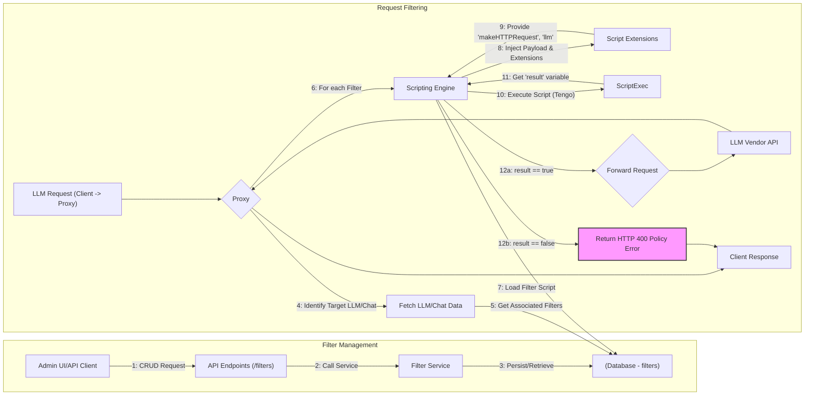

## Filters Functionality

**1. Overview & Purpose**

The Filters feature allows administrators to define and apply custom logic to intercept and potentially block or modify requests flowing through the Midsommar proxy before they reach the upstream Large Language Model (LLM) vendor. Filters act as policy enforcement points.

**Key Objectives:**

*   **Policy Enforcement:** Implement custom rules based on request content (payload). Examples include data loss prevention (DLP), content moderation, prompt injection detection, or enforcing specific formatting.
*   **Request Blocking:** Prevent non-compliant requests from reaching the LLM vendor, returning an error (HTTP 400 Bad Request with a `Policy error: <filter> - <message>` reason) to the client. Tool filters on `/tools/` block with HTTP 403 instead: the two codes distinguish a request the caller can fix (an LLM prompt the policy rejected) from an action the caller is not permitted to take.
*   **Flexibility:** Allow administrators to write custom logic using a scripting language (Tengo) to address diverse policy needs.
*   **Granular Application:** Apply filters globally (via proxy configuration, though less explicit in current findings) or specifically to individual LLMs or Chats.

**User Roles & Interactions:**

*   **Administrator:** Creates, manages, and assigns Filters via API/UI. Defines the script logic for policy enforcement.
*   **AI Developer/App Owner:** Associates existing Filters with their Chats or uses LLMs that have Filters applied.
*   **End User (Chat):** Interacts indirectly; may encounter a "Policy error" (HTTP 400) if their request violates a Filter's rules.

**2. Architecture & Data Flow**

**Core Components & Interactions:**

*   **API (`api/filter_handlers.go`):** Provides CRUD endpoints (`/filters`) for managing Filter resources (Name, Description, Script).
*   **Service (`services/filter_service.go`):** Implements the business logic for managing Filters (Create, Get, Update, Delete, List). Interacts with the Database.
*   **Database (`models/filter.go`):** Stores Filter definitions (`filters` table), including the `script` (byte array containing Tengo code). Also stores associations (e.g., `llm_filters` join table for LLM-Filter links, `chat_filters` for Chat-Filter links).
*   **Proxy (`proxy/proxy.go`):** The central component that intercepts LLM requests and applies Filters.
    *   Retrieves associated Filters (e.g., `llm.Filters` for the target LLM).
    *   *Dependency:* Uses the **Scripting Engine** (`scripting/scripting.go`) to execute each Filter's script.
*   **Scripting Engine (`scripting/scripting.go`):** Responsible for executing Filter scripts.
    *   Uses the `tengo` scripting language interpreter.
    *   Injects the request `payload` (as a string) into the script's context.
    *   *Dependency:* Uses **Script Extensions** (`scriptExtensions/script_extensions.go`) to provide custom functions (`makeHTTPRequest`, `llm`) callable from within the script.
    *   Expects the script to return a boolean `result` variable.
*   **Script Extensions (`scriptExtensions/script_extensions.go`):** Provides custom functions accessible within Filter scripts.
    *   `makeHTTPRequest`: Allows scripts to make external HTTP calls.
    *   `llm`: Allows scripts to call Midsommar's LLM service, potentially invoking other models.
*   **Models (`models/llm.go`, `models/chat.go`):** Define the relationships between LLMs/Chats and Filters (many-to-many).

**Data Flow (Simplified):**

**Flow Explanation:**

1.  **Management:** An Admin uses the API (likely via a UI) to Create/Read/Update/Delete Filters. The API calls the `Filter Service`.
2.  The `Filter Service` interacts with the `Database` to store/retrieve Filter definitions (Name, Description, Script). Filters can be associated with LLMs or Chats via separate API calls (e.g., `PATCH /llms/{id}`, `PATCH /chats/{id}`, `POST /tools/{id}/filters/{filter_id}`).
3.  **Filtering:** A client sends a request intended for an LLM via the `Proxy`.
4.  The `Proxy` identifies the target LLM (and potentially the Chat context).
5.  It fetches the LLM/Chat details from the `Database`, including any associated `Filter` IDs.
6.  For each associated `Filter`, the `Proxy` instructs the `Scripting Engine` to run it.
7.  The `Scripting Engine` loads the `Filter.Script` code from the database (or cache).
8.  It prepares the execution environment, injecting the request `payload` and making custom functions (`makeHTTPRequest`, `llm` from `Script Extensions`) available to the script.
9.  The Tengo script is executed.
10. The `Scripting Engine` retrieves the value of the `result` variable set by the script.
11. If `result` is `true`, the filter passes, and the `Proxy` proceeds (either to the next filter or to forwarding the request).
12. If `result` is `false` (or not set), the filter fails. The `Proxy` immediately stops processing and returns an HTTP 400 Bad Request error ("Policy error: {Filter Name}") to the client. The block is written to the proxy log as a 400 with a `policy_violation` body (`filter_blocked` for a response filter); the Compliance overview recognises those bodies, so filter and guardrail blocks count as policy violations alongside 403s.
13. If all filters pass, the `Proxy` forwards the request to the upstream LLM Vendor.

**3. Implementation Details**

*   **Script Language:** Filters are written in Tengo (`github.com/d5/tengo`).
*   **Script Input:** the script reads an `input` map: `raw_input` (the request body as a string), `messages` (normalised chat messages), `vendor_name`, `model_name`, `context` (`llm_id`, `app_id`, `request_id`) and, on the response side, `is_response`, `is_chunk`, `chunk_index`, `current_buffer` and `status_code`.
*   **Script Output:** the script assigns an `output` map: `block` (bool, stops the chain), `payload` (rewritten body; empty means unchanged), `messages` (rewritten messages, an alternative to `payload`, rebuilt into the vendor's wire format by the message reconstructor) and `message` (block reason). The legacy `payload`-in / `result`-out contract is no longer supported anywhere; the microgateway's last implementation of it (`FilterService.ExecuteFilter`) had no callers and was removed.
*   **Execution Context:** Scripts run within the `Scripting Engine` (`scripting/scripting.go`). They have access to Tengo's standard library and custom Midsommar functions provided via `scriptExtensions`.
*   **Custom Functions:**
    *   `tyk.makeHTTPRequest(method, url, body, headers)`: Makes an HTTP call.
    *   `tyk.llm(llm_id, prompt)`: Calls another LLM managed by Midsommar.
*   **Compliance Events:** Scripts can optionally include a `compliance_events` array in the output object. Each event requires an `event_type` (string), and can include `severity` ("info"/"warning"/"critical"), `description` (string), and `metadata` (map). Events are stored in the `compliance_events` table (`models/compliance_event.go`) for audit reporting via `GET /compliance/events`. Events are non-blocking and do not affect the filter's block/allow decision.
*   **Error Handling:** Compilation or runtime errors in the script, or `output.block = true`, lead to request rejection (HTTP 400 on the proxy, `Policy error` message). On the `/ai/` shim for non-Bedrock vendors the filters run on the inner `/llm/call/` loopback hop; that hop is marked with `X-Tyk-Internal-Hop` by the loopback transport and answers a block in the OpenAI error envelope (`respondPolicyBlock`, `proxy/proxy.go`), because the langchaingo drivers keep an upstream error's message only in that shape. Without it the caller saw "API returned unexpected status code: 400" and no reason. Drivers that cannot read that envelope at all (Google AI's) are covered by the outer hop reading the refusal from the loopback response itself (see "Loopback refusals" in `features/Proxy.md`), so the block message reaches the caller on every vendor's route. Direct `/llm/` callers keep the pass-through's own `ErrorResponse` shape.
*   **Script Panics:** Tengo panics rather than returning an error for faults it does not model (integer divide by zero being the common one), and filters run on the goroutine serving the request. `scripting.RunScript` therefore recovers and converts the panic into an ordinary script error, so a malformed script costs a single failed request instead of the whole process. The microgateway runs filters through the same shared `proxy` package, so it inherits this behaviour. The recovered error carries the underlying fault and is logged with the full stack. Each call site then applies its existing policy: request filters fail closed (request rejected), response filters fail open.
*   **Runtime Limits:** the enterprise runner (`enterprise/scripting/scripting.go`) bounds every execution. `FILTER_SCRIPT_TIMEOUT` (default 5s) aborts the Tengo VM via `RunContext`; the context is also the request or chat-session context (`ScriptInput.Ctx`), so a caller that goes away cancels its scripts. `FILTER_SCRIPT_MAX_ALLOCS` (default 10M) caps VM allocations. The `os` stdlib module is withheld unless `FILTER_SCRIPT_ALLOW_OS=true` (dangerous: environment, files and process execution; AI Studio and the microgateway log a startup `SECURITY WARNING` when it is on, `pkg/filterscript`); every other module (`text`, `json`, `math`, `times`, `rand`, `fmt`, `base64`, `hex`, `enum`) is pure computation. Compiled scripts are cached per (source, service, limits) and each run executes on a `Clone()`, so runs never share state and compilation is paid once per filter rather than once per request.
*   **Outbound Calls:** `tyk.makeHTTPRequest` (`enterprise/scriptExtensions/httpcaller`) uses `pkg/netguard`'s validating transport (scheme and `LLM_UPSTREAM_*` host policy on every request including redirects, dial-time internal-range blocking), a per-call timeout (`FILTER_HTTP_TIMEOUT`, default 10s) and a response cap (`FILTER_HTTP_MAX_RESPONSE_BYTES`, default 1 MiB; exceeding it is an error, not a truncation). `tyk.llm` (`enterprise/scriptExtensions/llmcaller`) resolves `$SECRET/` and `$ENV/` references on the LLM before building the driver (the service interface's `GetLLMByID` preserves references for API responses, which previously sent the literal reference as the bearer token) and bounds the call with `FILTER_LLM_TIMEOUT` (default 30s). Limits are read from the environment at the point of use (`enterprise/scriptExtensions/scriptenv`).
*   **Association:** Filters are linked to LLMs and Chats via many-to-many relationships in the database, managed through the respective entity's update endpoints or specific association endpoints (like for Tools).
*   **API Endpoints:**
    *   `POST /filters`: Create a new Filter.
    *   `GET /filters`: List all Filters (paginated).
    *   `GET /filters/{id}`: Get a specific Filter.
    *   `PATCH /filters/{id}`: Update a Filter.
    *   `DELETE /filters/{id}`: Delete a Filter.
    *   `PATCH /llms/{id}`: (Likely includes `filter_ids` in payload to associate filters).
    *   `PATCH /chats/{id}`: (Likely includes `filter_ids` in payload to associate filters).
    *   `POST /tools/{id}/filters/{filter_id}`: Add a filter to a tool.
    *   `DELETE /tools/{id}/filters/{filter_id}`: Remove a filter from a tool.
    *   `PUT /tools/{id}/filters`: Set all filters for a tool.

**3b. Guardrail Filters (provider kind)**

A filter has a `kind`: `script` (default, the Tengo contract above) or `guardrail`. A guardrail filter carries a `config` (`guardrails.Config`: provider, detectors with optional thresholds, exclude list, scope, on_detect, redaction, fail_mode, timeout_ms, stream cadence, block_message, connection) instead of a script, and runs a typed provider.

*   **One execution chain:** `scripting.NewFilterRunner(filter)` (`scripting/filter_runner.go`) returns the Tengo runner for a script and the guardrail runner for a guardrail; every call site (proxy request and response, chat request/response/file, tool input/output, the `/filters/test` endpoint) constructs its runner through it. The test endpoint honours `$SECRET/` and `$ENV/` connection references only when `filter_id` names a saved filter whose provider and connection block are identical to the posted ones (`guardrailTestReferencesAllowed` in `api/filter_handlers.go`); otherwise the request is refused before any provider call, so execute permission on filters cannot be used to route a resolved secret to a caller-chosen endpoint. Provider instances are cached per normalised config in a bounded LRU (`guardrails/providers.go`, 256 entries, `pkg/lrucache`, whose `Do` shares one build between concurrent misses), and the edge snapshot resolves each distinct reference once per build. Note the privilege this implies: write permission on filters, like write permission on LLMs, lets a user point a stored `$SECRET/` reference at an endpoint of their choosing; the reference model puts secret values in the store rather than in the filter, and the secret is only ever sent from the gateway, but who may edit filters is a decision to make with that in mind. The runner keeps a prepared entry (parsed, normalised, references resolved, provider built) per saved filter version, keyed on ID and UpdatedAt, for 30 seconds (`preparedTTL` in `scripting/filter_runner.go`): a request pays no JSON round trips or secret-store reads for a guardrail prepared within that window, and a rotated secret takes effect within it. Filters without an ID (the test endpoint's temporary filter) are never cached. The edge adapter likewise parses the hub's config JSON once per distinct text, keyed on its SHA-256 (`parsedGuardrailConfig` in `gateway_adapter.go`), and copies the hub's timestamps onto the model so the runner key works at the edge. The key is the text, not the filter's version, because the hub resolves secret references into the snapshot: a rotated secret changes the text but not UpdatedAt (midsommar-clean-01t; keying on ID@UpdatedAt and the text's length kept a same-length rotated key out of the edge until restart). The runner's prepared entry is keyed on ID@UpdatedAt plus an HMAC of the filter's config (`preparedKey`, `guardrails.CacheDigest`, keyed per process), so a config that changes under the same version stamp is a new entry at once: on an edge, the next snapshot's resolved secret is used on the next request. On the hub the stored config keeps the `$SECRET/` reference, so a value rotated in the secret store takes effect when the prepared entry expires (`preparedTTL`, 30s); during that window a revoked key is an operational provider error and follows the fail mode. Validation failures wrap `guardrails.ErrInvalidConfig`, `guardrails.ErrUnknownProvider` or `services.ErrInvalidFilterSpec`, which is what `filterErrorStatus` maps to 400. The guardrail runner maps `ScriptInput` onto provider segments (scope selection on proxy requests; the raw text on chat, tool and response paths; the accumulated buffer when streaming), runs the provider under `timeout_ms`, and maps the verdict back onto a `ScriptOutput`: `Block` with the configured message, a rewritten `Payload` (chat, tools; and proxy requests in a format `guardrails/segments` reads, where `ScriptInput.Format` names the format and the redaction is spliced into the body at each segment's path, so tool blocks and ids survive), rewritten `Messages` (proxy requests in other formats: decisions, Responses, embeddings; rebuilt by the reconstructor registry), or nothing for `log`. Scope selection on segmented bodies is by role as before, one provider segment per unit: tool results only under `all_messages`, `last_user` = the user text of the last message that has any. A redaction that cannot be mapped back onto the body (it ran across a block boundary or touched a functionResponse key, both arrangeable by whoever wrote the text) never falls to the fail mode (`redactBody`): a tool unit is quarantined instead, any other unit blocks the request, and a `guardrail.unredactable` event records it. `quarantine` (`guardrails.ActionQuarantine`, request filters only; Normalize rejects it on response filters, which include tool output filters) replaces each flagged unit as a whole with `quarantine.placeholder` (default `[content removed by policy: {{detector}} detected in {{source}}]`, plain `ReplaceAll` of `{{detector}} {{category}} {{source}} {{tool_name}}`, each value reduced to `[A-Za-z0-9_.:-]{0,64}` by `safeLabel`) and lets the request continue: `Unit.Quarantine` replaces the unit's node with a string where it owns it (OpenAI message content, Anthropic tool_result content, Anthropic system), with `{"output": placeholder}` for a Google functionResponse response, and otherwise each leaf. A unit it cannot replace (a generic body, whose keys are detection text) turns the action into `block`; so does a response. Payload inputs (chat, tool call envelopes) are replaced whole, messages-mode formats through the reconstructor. A finding with no valid segment index, or a flagged verdict with no findings, quarantines every segment of the call. Compliance events carry `action: quarantine`, `roles` and `tool_names`. Tool results (4uc.5): `guardrails.Config.ToolResults{Scan *bool, OnDetect}`; `ScansToolResults()` is true when `scan` is absent (stored configs from before the key scan tool results; `*bool` survives the edge snapshot) and `ActionFor(kind)` gives a tool result `tool_results.on_detect`, else the filter's action with block mapped to quarantine. `selectInScope` (scripting) scans tool units across the whole history under every scope when scanning is on; the scope selects the rest (`last_user` = user text of the current turn, by `Turn`); with `scan: false` selection is the 4uc.2 one. Messages-mode formats (Responses, decisions) select role tool / function messages the same way. Responses tool outputs are named (4uc.62): the extractor returns, through the optional `messageTools` method (`MessageExtractorRegistry.MessageTools`), a `scripting.MessageTool{Name, CallID}` per extracted message, which the proxy puts in `ScriptInput.MessageTools` (not script-visible; refreshed when a filter rewrites the body). A `*_call_output` is named by the function or custom tool call with its `call_id`, an `mcp_call` by its own name and id, each tool `mcp_list_tools` lists by that tool, and built-in tool results by the type without `_call` (`file_search`, `code_interpreter`) and the item id. `messagesSelection` copies them onto tool segments, so tool-aware providers, quarantine placeholders and compliance events (`tool_names`) see them as on the other formats. `decide` gives each flagged segment its own action (block wins overall: a flagged user message under block still returns the 400); an unscanned or unmappable redaction falls back to quarantine for a tool unit and block otherwise; `outcome.apply` writes redactions and quarantines in one pass. Providers declare `Capabilities.ToolSegments`; without it `providerSegment` sends tool units as role user with no tool metadata (findings map back by index), with it as role tool with kind, tool name and call id; the verdict cache key includes the flag. Compliance events add `kinds`. Studio chat (4uc.7): `ChatSession.screenToolResult` (chat_session/tool_guardrails.go) runs the chat's request-side guardrail filters (not script filters) over each tool output with `ScriptInput.Format = scripting.FormatToolResult` and `tool_name` / `tool_call_id` in the context, after the tool's own output filters and before `EventToolResult`, the result part and the history append: REST outputs, the upstream error text of a failed call, and client-tool (HITL) answers in `resumeWithToolResults`. The runner reads such an input as one tool unit (JSON decoded via `segments.Generic`, else text), skips it when `tool_results.scan` is false, and a quarantine replaces the whole output (`selection.replaceWhole`). A block puts `ToolBlockedMessage` in the result, sets `toolResultBlocked`, and `HandleLLMResponse` stores the turn and sends `errToolResultBlocked` instead of calling the model again (a parked client-tool turn keeps waiting with the notice in place); a guardrail error blocks. Events are recorded with filter scope `chat_request`. Scripts (4uc.11, enterprise/scripting): `ScriptInput.Format` reaches the Tengo engine; `input.format` and `input.segments` (`segments.Read` units: index, role, kind, tool_name, detection text; built only when the script source mentions "segments") are added without changing `input.messages`; `tyk.quarantine_segment(input, index, placeholder)` (scriptExtensions/guardrail_funcs.go) re-reads the body, bounds-checks the index and returns the body with `Unit.Quarantine` applied, or an error value. Template "Built-in library: scan tool results" (the script in scripting/script_segments_ent_test.go). Chat (4uc.36): `runScriptRequestFilters` runs the chat's script request filters over client-tool answers before the guardrails. The typed-message filters, `runScriptRequestFilters` and `screenToolResult` share one loop, `ChatSession.runRequestFilters(ctx, text, filterPass)` (which filters, message role, Format, extra context keys), returning the `filterStop` that blocked or failed (4uc.56). Panics (4uc.48): `guardrailRunner.RunScript` recovers any panic in the run (prepare, factory, body reading, outcome) and blocks a request whatever the fail mode (a response follows the stored fail mode), recording `guardrail.error` with `error_class: panic` and no panic value (type and stack logged at error, value at debug); the chat session loop runs each turn and response under `safe.Call` (`errTurnFailed`), and native batch workers run each item's filters under `safe.Call` (`errItemFiltersFailed`). Decoded views (4uc.35/.37): for a tool unit whose leaf text is a JSON object or array, `segments.JSONView` (`decodedView`; for text that is not valid JSON but holds escapes, `unescape` decodes every JSON escape in place; 4uc.43) (json.Decoder tokens, so repeated keys are kept, every copy) adds a detection-only view segment with all keys and strings decoded (`selection.addView` / `addDecodedViews`, the same mechanism as `Joined`, folded by `foldViews`); a chat tool output that `Generic` refuses (a repeated key) is classified as text plus that view, never raw text alone. Text documents sent as base64 (4uc.33): Bedrock document formats txt/md/html/csv (`source.bytes`) and Anthropic base64 documents with a `text/` media_type are decoded (`extraction.decodedText`, up to 16 MiB) into detection-only text of their unit; padded or unpadded base64 is accepted, bytes that are not UTF-8 are read as lenient UTF-8 plus a Windows-1252 view (4uc.39), and only bytes that are not base64 mark the unit `Undecodable`, and the runner records it as unscanned (reason `undecodable`), so it takes the filter's action. Edges before this release ignore `tool_results` and do not scan tool results. Edge version skew: `guardrails.ConfigJSONForEdge` sends an action outside block/redact/log as `on_detect: block` plus `on_detect_ext: <action>`; `ParseConfig` folds a known `on_detect_ext` back into `OnDetect` (an unknown one leaves the hub's block) and the field is never stored. A v2.2.x edge therefore loads the config and blocks on a hit; `guardrails/edge_compat_test.go` checks this against the v2.2.2 package vendored in `guardrails/internal/v222`. Script filters that return `messages` still go through the reconstructor, which flattens tool-using conversations; the filters doc says so. Findings become one compliance event per detector (`guardrail.<detector>`), never carrying the matched text. Fail mode is applied inside the runner: `closed` blocks, `open` passes, both record `guardrail.error`; defaults are closed on the request/tool side and open on the response side, matching script semantics. `redact` on the LLM response path degrades to `log` (responses are block-only). Streaming uses a stateless cadence: the provider runs when the buffer crosses a multiple of `evaluate_every_chars`, and once more on the end-of-stream run (`ScriptInput.IsFinal`, added to `proxy.ExecuteFinalResponseFilters` and called after the pass-through streaming loop in `proxy/proxy.go`), so a response shorter than the cadence is still evaluated in full. Scripts see that run as one more chunk with `is_final: true` and an empty `raw_input`. A block on the final run appends the error chunk and logs a blocked response; the content already streamed has reached the client, which is inherent to streaming. A caller that hangs up mid-stream (`clientGone` in the pass-through streaming loop: a failed write, or an upstream read cancelled with the request context) no longer drops the exchange from the proxy log; only an upstream failure does. The `/ai/` bridge streams from `/llm/call/` internally, so response guardrails on it have streaming semantics even for non-streaming clients; the `/llm/rest/` pass-through buffers and blocks fully.
*   **Provider framework:** `guardrails/` (core) holds the `Provider` interface (`Classify(ctx, Input) (Verdict, error)`, `Capabilities`), the config parser/normaliser, a provider catalogue (`Specs()`, served by `GET /filters/guardrail-providers`) and a factory registry. Implementations live in the Enterprise submodule and register in `init()`; `scripting/guardrails_ent.go` imports them under the `enterprise` tag. With no factory registered (CE) the runner passes through with a warning, like the script stub.
*   **Request segmentation:** `guardrails/segments` reads a request body block by block without loss, for the OpenAI / Ollama, Anthropic, Google AI / Vertex and Bedrock formats (`bedrock`: Converse, whose toolResult content is text and json blocks, quarantined as `[{"text": placeholder}]`; an InvokeModel body with `anthropic_version` is read as Anthropic). `Extract(format, body)` returns one `Segment` per string leaf (role `system|user|assistant|tool`, kind `text|tool_result`, tool name, tool call id, message position and turn, and a JSON Pointer `Path` to the leaf); `ExtractUnits` returns the detection units: one per message's text and one per tool result, whose `Text` joins the unit's leaves with a whitespace separator (`\n\f\n`, longer if a leaf contains it), so an injection split across two blocks is one text. Units whose blocks a vendor may set side by side (Anthropic text blocks of one message or tool_result, OpenAI text parts, Google text parts of one content, all pieces being leaves) also carry `Joined`, the leaves with nothing between them; the runner classifies it as an extra, detection-only segment so a word split inside across two blocks is caught. `foldJoined` moves its findings onto the unit (dropping ones the unit's own text also has), discards its rewrites, and marks a unit flagged only there as unredactable (tool unit quarantined, anything else blocked). A Google `functionResponse` unit also carries the response's keys as detection-only text. `Unit.MapRewrite` maps a rewrite of the unit text back onto leaf edits (or reports that it cannot: a redaction across a block boundary, or of a key), and `Apply(body, edits)` splices them into exactly those leaves, checking each still holds the classified text, so tool blocks, ids, images and `cache_control` survive. Tool results covered: OpenAI `role: tool` and legacy `function` messages, Anthropic `tool_result`, `mcp_tool_result`, `web_fetch_tool_result`, `web_search_tool_result`, the code execution results and any other `*_tool_result` block, Google `functionResponse` and `codeExecutionResult` (both proto JSON spellings). Unknown block and part types are never skipped: their strings, minus type, ids, signatures and encrypted fields, join the enclosing unit. Errors: a repeated key anywhere, two keys equal under case folding, or a case variant of a field the format reads (`"Content"`, which Go struct decoding on the Bedrock bridges would read) is `ErrDuplicateKey`; the request is refused. A JSON body no segmenter reads (`ErrUnrecognisedBody`, `ErrUnsupportedFormat`: Hugging Face, another vendor's shape) is classified through `Generic`: one user unit of every decoded string, keys included, so JSON escapes cannot hide a phrase and redaction still lands in place. Only a body that is not JSON is classified as raw bytes. `proxy.runRequestFiltersWith`, which the pass-through, the Bedrock bridges, native API items and the edge all call, refuses a body with a repeated key whenever request filters are attached (`segments.CheckKeys`), whatever the filter kind or format.
*   **Remote providers:** `enterprise/guardrails/providers` implements the generic HTTP classifier (documented JSON contract, for Prompt Guard 2 / LLM Guard / in-house models), Presidio (analyze + optional anonymize), Lakera Guard v2 (breakdown + payload spans), Azure AI Content Safety (Prompt Shields + text:analyze with severity thresholds, 10K-char pieces), Azure AI Language PII (batched analyze-text with code-point offsets, local rewrite in the filter's style) and Amazon Bedrock Guardrails (ApplyGuardrail via the AWS SDK, masked outputs as rewrites). All HTTP calls go through `pkg/netguard`'s validating transport with a 4 MiB response cap; the Bedrock SDK client is routed through the same transport. Each provider has httptest-driven tests (`providers_test.go`); Bedrock is tested through a fake of the one SDK method it uses. The HTTP classifier declares `ToolSegments` and sends its own wire type (`httpSegment`): tool results carry `role: tool`, `kind`, `tool_name` and `tool_call_id` (the two labels cut to 256 bytes at a rune boundary), other segments none of them, so existing classifiers see unchanged JSON (`TestHTTPProvider_ToolSegmentOnTheWire`).
*   **Conformance suite:** `guardrails/conformance` (`Run(t, newProvider, Options)`, `Check` for the failures as data) drives a provider with what the runner sends (`Segment.ForProvider`, shared with the runner, so the suite cannot drift from it): a probe in a tool result beside user text and the reverse, the probe in the middle of several tool results, empty and whitespace tool output, a tool result at the provider's size limit (`MaxChars`, `MaxCallChars`, else 32K), a redaction probe, and a hostile tool name; segment indices are deliberately not positions. Checks: no error, findings name the probe's segment by Index (unpinned findings only with `AllowUnpinned`), no finding on benign or empty text, rewrites only on the flagged segment and changed. Self-tests run deliberately broken fakes through it. Each call runs in a goroutine of its own: a panic, or a return more than 500ms after the call's context ended, is a failure, never a crash or a hang (midsommar-clean-4uc.41). The runner matches it: `run` stops waiting for calls in flight `callGrace` (100ms) after the time budget runs out, marks them failed, and leaves their goroutines to finish into a buffered channel, so a provider that ignores its context cannot hold a request past `budget.time_ms`. Every shipped provider passes it, the vendor ones against fakes of their services (`vendor_tool_segments_test.go`); `TestEveryRegisteredProviderRunsConformance` in the providers package fails for a registered provider without a run. Vendor tool handling (midsommar-clean-4uc.12): Lakera sends each segment as its own one-message request (Lakera screens only the last interaction and treats earlier messages as unscreened context), a tool result as role `tool`; findings and rewrites land by segment, so it is not `Contextual` and the verdict cache holds; the price is no cross-message context. Azure Content Safety sends user text as `userPrompt` and a tool result as a Prompt Shields document (indirect attack), one segment per request as before, `MaxCallChars = MaxChars`. Azure Language PII and Presidio are role-agnostic NER and declare `ToolSegments`; code-point offsets are tested on non-ASCII tool output. Bedrock makes one `ApplyGuardrail` call per segment (assessments are per call, not per content block; the old mapping put extra findings on the first segment), and does not declare `ToolSegments`: it has no tool notion and its qualifiers are for grounding. The live suite (`tests/guardrailconformance/tool_results_live_test.go`, `TestGuardrailToolResults`) sends each provider a benign user message beside a tool result with an injection, then with personal data, and asserts findings and rewrites land on the tool result.
*   **Built-in provider:** `enterprise/guardrails/builtin` is the pattern library: RE2 patterns with validators (Luhn, IBAN mod-97, SSN ranges, NINO prefixes, NHS mod-11, Shannon entropy) in four categories (secrets, pii, injection, leak), compiled once; redaction by placeholder, mask or hash with overlapping matches merged. Also exposed to scripts as `tyk.detect` and `tyk.redact` (`enterprise/scriptExtensions/guardrail_funcs.go`). It declares `ToolSegments`; on a tool result a pattern's `ToolRegex` replaces its regex and `SkipTool` leaves it out (base64_blob skipped; pseudo_tags template tokens, and a `system:`/`assistant:` line only with an imperative cue within 80 characters (ignore, disregard, forget, override, you must, you are now, new instructions; 4uc.38); role_hijack "you are now" only with a persona; markdown_exfil only with a 32+ character query value; indirect_marker only when the words address the model, i.e. the phrase ends ("Attention AI:", end of line) or goes on with what the model is doing ("... reading this", a relative clause "... who reads / that is processing ...", optionally after "and <word>": "AI agents and tools listening"), and "all/any/every <addressee>" only with the latter, so "assistant manager", "Attention AI researchers" and "Note to all assistants:" do not fire (4uc.42, 4uc.51)). Everywhere, `connection_string` and `basic_auth_url` take the `notPlaceholderPassword` validator: `$UPPER_CASE`, `${UPPER_CASE}`, `${UPPER_CASE:-default}` / `${UPPER_CASE-default}` whose default is empty or itself a placeholder, `<words>` (letters, `-`, `_`, up to two trailing digits, at most 41 characters), or one of only `* x X # •`, is not a credential; any other bracketed value is (4uc.42, 4uc.52), and the JSON escapes `\n \r \t` are read as two spaces (same byte offsets, so spans and redaction hold). The choices are pinned by a false-positive corpus of realistic tool output and an injected corpus (`testdata/tool_corpus`, `corpus_test.go`): with `secrets` and `injection` the benign corpus and the separately written `benign_extra` corpus raise nothing; `tool_markers_test.go` pins the marker and placeholder cases. Scanning (4uc.58): Go's regexp walks every byte of a large text through its NFA (about 13 ms per MiB per pattern) unless the pattern starts with a literal, and the library's start with `\b` or a class, so a full scan took about 1.1 s per MiB. Each regex now runs through a `plan` (`prefilter.go`) that returns exactly `FindAllStringSubmatchIndex`: a match is a run of the bytes the regex can consume (`alpha`, from the `regexp/syntax` tree; any rune outside ASCII adds every byte from 0x80) and so lies inside one segment (maximal run of them); a segment shorter than the shortest match, or without one of the regex's required literals (`analyze`: exact and required string sets through concatenation, alternation and repetition, ASCII lower-cased, found in one Aho-Corasick pass over the lower-cased text, `literalMatcher`), cannot hold one; the regex runs on each remaining segment with the real rune before it (`(?s:.)(re)`, groups shifted by one) and after it, taking matches from where the last ended as FindAll does, and a plan whose segments cover over half the text scans it whole. A case-insensitive literal with s or k also matches U+017F or U+212A, which ASCII lower-casing misses, so such a text turns those plans' literal filter off. `TestPlanMatchesFindAll` holds plans to FindAll on the corpus and generated text (word boundaries, line starts, fold runes, broken UTF-8, JSON escapes; every plan must match, and a context-free variant must be caught). `Classify` checks its context in the literal pass, between patterns, every 16 regex calls and every 1024 matches validated, and a cancelled scan returns the context's error and no verdict (unscanned, not cached). `BenchmarkScan` (M-series, every category, per MiB): prose 71 ms (was 1.09 s), as a tool result 102 ms, emails 76 ms, IPv4-dense 150 ms (was 1.62 s), digit-dense 330 ms (was 1.36 s), and text built to keep the slow plans' segments long 310 ms; 16 MiB of prose 1.14 s (was 17.7 s). With the 8 MiB cap and 2 s/MiB allowance a call costs at most about `timeout_ms` + 16 s, of which one regex call (at most ~0.28 s) cannot be interrupted. `TestBuiltinFloodLeavesOtherTenantsScanned` (scripting, enterprise) floods the 4 large-call slots from two tenants with tool results just under the cap and checks a third tenant's small requests are scanned and passed within half their budget: they take the small-call pool (4uc.69), so they finish in under a millisecond even under `-race`, where the flood's scans run to their 18 s deadline.
*   **Connection references:** both resolution points (`prepare()` in `scripting/filter_runner.go` and the snapshot's `resolveRef` in `grpc/control_server.go`) go through `guardrails.ResolveConnectionValue`, i.e. the platform policy `secrets.ResolveRef` (`secrets/refpolicy.go`): `$SECRET/` via the secret store, `$ENV/` only for names on the operator allowlist `AI_STUDIO_ENV_REF_ALLOWLIST` (`secrets.EnvRefAllowed`; empty by default, no prefixes). The snapshot never sends a reference name to edges (`guardrails.EdgeConnectionValue`): a value still holding a reference goes out as the dud key `secrets.RefusedCredential` for a field the provider marks `Secret` (or does not declare), since a provider client may fill an empty key from its own environment (the AWS default chain), and as a bare `$ENV/` (`secrets.ForEdge`) for other fields such as endpoints; edges before 2.3 resolve `$ENV/` against their own environment, which a bare `$ENV/` turns into empty. The runner treats `RefusedCredential` as unresolved too (`guardrails.IsReference`), so no provider is built with it. The same `secrets/refpolicy.go` and `api.requireSecretReadForKeys` serve every resolved field (bead .63). A value still holding a reference after resolution makes `prepare()` fail, so the fail mode applies and the literal reference is never sent. REST create and update (`requireSecretReadForGuardrailReferences` in `api/plugin_secret_refs.go`, using `guardrails.NewConnectionReferences`) require `secrets:read` for a new, changed or moved `$SECRET/` or `$ENV/` reference in `connection` (`secrets.NewReferences`). The gRPC filter RPCs cannot set `kind` or `config` (they keep the stored ones), so they cannot add a reference.
*   **Edge sync:** `FilterConfig` carries `kind` and `config` (JSON) in the snapshot; `grpc/control_server.go` resolves allowed references in `connection` for the edge (`guardrails.ConfigJSONForEdge`), the edge `Filter` row stores them, and `gateway_adapter.go` maps them back onto `models.Filter` (`convertDatabaseFilterToModel`), so the shared runner needs nothing edge-specific. The gRPC-cache converter now also carries `response_filter`, which it previously dropped.
*   **Seeding:** `models.GetOrCreateDefaultFilters` creates five unattached built-in guardrails on every Enterprise start (skipped with `SKIP_FILTER_DEFAULTS=true`), matched by name including soft-deleted rows so nothing is resurrected or overwritten. Matching by name is also the upgrade path: v2.3 adds "Prompt injection in tool results (quarantine)" (`on_detect: log`, `tool_results: {scan: true, on_detect: quarantine}`) to installs that have the earlier four, leaving those rows untouched (`models/filters_seed_tool_results_test.go`: fresh install and upgrade).
*   **Live E2E:** `tests/guardrail_tool_results/` starts an Enterprise Studio and a microgateway from local binaries against a recording mock upstream and checks what reached the vendor for every vendor format, buffered and streamed, on both planes, plus Studio chat with a REST tool and native batches (see its README for the scenario list).
*   **Scanning, budgets and the verdict cache:** the runner hands the selected segments to a `scanJob` (`scripting/guardrail_scan.go`), which answers what the verdict cache knows, splits the rest into pieces (`Capabilities.MaxChars`, with a seam of `min(512, MaxChars/4)` runes across each cut; a redacting run checks the seams on the redacted text afterwards), packs pieces into calls by trust class, tool results apart from user and system text so a tool result that makes its call fail costs only tool results (`packByTrust`, midsommar-clean-4uc.30; a small run may therefore be one call per class); a provider that declares `Capabilities.SegmentPerCall` (Lakera, Bedrock, Presidio, both Azure providers: one vendor request per segment) gets each segment in calls of its own (`packPerSegment`, midsommar-clean-4uc.44), so a cold cache's many tool results run four at a time, each under `timeout_ms`, instead of sequentially inside one timed-out call, and for them a run is small with up to one parallel wave of calls per class (`smallRunWave` = 4, its own constant so more parallelism never widens the fail-mode exemption; `callsWithinSmallRun`, midsommar-clean-4uc.50), so a system and user prompt keep fail open through an outage while a fifth tool result makes the run large (`Capabilities.MaxCallChars`; a remote provider that declares none gets `guardrails.DefaultCallChars`, 32768; Azure Content Safety and Azure PII declare their `MaxChars`, so one piece per call) and runs them four at a time. Request-side budgets (`guardrails.Budget`, config key `budget`: `max_scan_chars` default 262144, `max_pieces` default 256, `time_ms` default 4 × `timeout_ms`, at least `timeout_ms`; `single_call_chars` default 32768; only the values the admin set are stored, `guardrails.ForStorage` on save and seeding, and the defaults are derived where the filter runs, since `time_ms` and `single_call_chars` follow `timeout_ms` and `max_scan_chars` and a stored derived value would make a later edit of those fail validation, midsommar-clean-4uc.34) apply to remote providers; a `Capabilities.Local` provider scans each segment in full up to `localMaxScanBytes()` (`GUARDRAIL_LOCAL_MAX_SCAN_BYTES`, default 8 MiB, bounded to 64 KiB-64 MiB on read; a larger segment is unscanned, reason `size`: a tool result is quarantined, other text takes the action). The caps are checked before any call. Text not scanned in full is never clean: a segment over a cap, a segment whose call failed in a run of several calls, a segment the provider refused (`guardrails.ErrInputRejected`; `guardrails.StatusError` matches it for 400, 413 and 422) in any run (a refused call of several segments is re-sent one segment per call by `resplit`, within the piece and time budgets, so only individually refused segments are flagged and a tool result built to be refused cannot take the user's prompt in the same call with it; segments the budgets leave no room for are flagged), and a redacting run's seam still flagged after redaction, get an `unscanned` finding (`res.unscanned`, reason `size`, `pieces`, `time_budget`, `input_rejected`, `provider_error`, `provider_panic`, `seam`; a provider that panics is recovered in its call's goroutine through `safe.CallRedacted` (the panic's type and stack at error level, its value at debug only, since it may quote the screened text; midsommar-clean-4uc.46), so the process survives, and its call's text is unscanned in any run like rejected input, midsommar-clean-4uc.40) and the filter's action, whatever `fail_mode`; `redact` becomes `block` for them. `fail_mode` decides only a small run, one call per trust class holding at most `budget.single_call_chars` (default 32768, at most `max_scan_chars`) of text, that fails operationally (timeout, 5xx, 429, 401, 403, network), as before; under fail open the capped segments of such a run still get their action. The exemption is by size, not call count (midsommar-clean-4uc.28: with every shipped remote provider declaring no call size, every run was one call, so padding plus an induced timeout fell to fail_mode); calls a refused run re-sends never make it small again. Under fail closed, a small run whose tool-only call fails operationally while the client's text was scanned does not block: the failed tool results (`res.failedTools`) are quarantined whatever the filter's action (`outcome.quarantine`, never log or redact; a unit that cannot be quarantined in place still blocks), the client's text keeps its own verdict, and a `guardrail.error` event records the error class, the quarantine and the tool names (midsommar-clean-4uc.32). If the client's call fails too, or alone, the request blocks as before; fail open is unchanged. The response side keeps one pass, no cache, no budgets, fail mode for every failure. Side effect, documented: a fail-open filter can block or quarantine a large request when its provider is slow or down (no outage exception, by decision; `tool_results.on_detect: log` lets such requests through but stops tool-result quarantine for that filter at all times, so the docs present it only as a temporary measure and point first at raising `budget.single_call_chars`; 4uc.70). Events: `guardrail.unscanned` per reason with count, roles, kinds, `max_chars` and `limit`. Provider errors reach events and logs as their class only (`guardrails.ErrorClass`: `timeout`, `input_rejected`, `http_<status>`, ...; `providerError` in the runner); `postJSON` and the Bedrock provider return `StatusError` without the response body, which is logged at debug at most. The verdict cache (`scripting/guardrail_cache.go`) is per process: a weighted LRU (`lrucache.NewWeighted`) bounded by `GUARDRAIL_VERDICT_CACHE_ENTRIES` (100000) and `GUARDRAIL_VERDICT_CACHE_MAX_BYTES` (64 MiB), entries valid for `GUARDRAIL_VERDICT_CACHE_TTL` (10m, `0` = off), read once from AppConf.FilterLimits or the environment. Keys are HMAC-SHA256 under a random per-process key over the filter version (ID@UpdatedAt), a digest of the normalised, resolved config, `Capabilities.Version`, direction, the redact flag, the tenant (`app_id`, else `user_id`, else `session_id`; none = no cache) and the segment's role, kind, tool name and text; tool call id, index and path are left out so history rescans hit. Only fully scanned segments of runs where no call failed are stored, never those that took a finding the provider did not pin on them. No cache for responses, unsaved filters (the test endpoint), `Capabilities.Contextual` providers or `config.cache: false`. Benchmark (`BenchmarkGuardrailScan_AgentBody1MB`, 1 MB OpenAI body with 200 tool results, free provider, M-series laptop): cold 8.7 ms/op, warm 7.9 ms/op; segmentation dominates, the cache's hit path is ~4% (one HMAC per segment).
*   **Admin UI (4uc.8):** `GuardrailConfigForm.js` shows a Tool results section on request filters (scan checkbox, checked unless `tool_results.scan === false`; action override whose empty entry is labelled with the effective action, `effectiveToolAction` mirroring `Config.ActionFor`), a quarantine placeholder when quarantine applies, and an Advanced accordion (cache, and budgets for non-local providers, validated by `budgetErrors` mirroring `Budget.normalize`). It writes `tool_results`, `quarantine`, `cache` and `budget` only when the admin sets them and removes a key reset to its default, so "absent" survives a save. Quarantine is offered on request filters only; `FilterForm` turns quarantine into block when the response box is ticked and drops the request-only keys from a response filter's save body. `FilterDetails` shows the effective tool-result settings. `ScriptTestPanel` sends `input.format` for request filters of either kind (`Request body format`; a script then gets `input.segments`, which the "Built-in library: scan tool results" template in `ScriptTemplateSelector.js` needs, kept verbatim with the Go `ScanToolResultsTemplate` by `ScriptTemplateSelector.test.js`) and has per-format tool-result samples. `compliance/eventSource.js` turns event metadata (`roles`, `kinds`, `tool_names`) into the source label used by the test panel and the Filter Events tab's Source column.
*   **Metrics:** `aistudio_guardrail_latency_seconds{provider,outcome,action,segment_kind}` per provider call, `aistudio_guardrail_errors_total{provider,fail_mode}` (`fail_mode` is `unscanned` for a failed call whose segments were flagged), `aistudio_guardrail_segments_total{provider,segment_kind,result}` (`scanned`, `cached`, `unscanned`) `aistudio_guardrail_cache_total{provider,outcome}` and `aistudio_guardrail_calls_abandoned_total{provider}` (`metrics.RecordGuardrail`, `RecordGuardrailError`, `RecordGuardrailSegments`, `RecordGuardrailCache`, `RecordGuardrailAbandoned`).
*   **Hang hardening (midsommar-clean-4uc.49):** `scanJob.run` is one event loop: each started call gets a deadline (`callWait`: `timeout_ms` + `callGrace`, plus `localScanAllowance()` per MiB of the call's text for a `Local` provider (`GUARDRAIL_LOCAL_SCAN_MS_PER_MIB`, default 2000 ms, bounded to 100-60000 on read; 4uc.58 set it from 5 s once the built-in library scanned 70-350 ms per MiB, leaving room for hosts several times slower)), on every path including local providers and the response side, which have no run-wide budget. A call past its deadline is abandoned (`context.DeadlineExceeded`, started) and its slot freed: the collector, not the call's goroutine, owns the slot, and a late result is ignored. The run budget's expiry still abandons everything in flight `callGrace` later. Each abandoned call is counted (`RecordGuardrailAbandoned`) and reported to the filter's `callBreaker` (`scripting/guardrail_breaker.go`; one per `preparedKey` in an LRU of `preparedMax`, outliving the prepared entry's TTL; none for unsaved filters). `breakerAbandons` (8) within `breakerWindow` (1m) suspends the filter's calls: `admit` refuses them with `guardrails.ErrProviderSuspended` (error class `suspended`, started, so `failureReason` gives the fail mode for a small run, `provider_error` otherwise, and the response side the fail mode). After `breakerCooldown` (10s) one probe goes; answering in time (any result, error or not) resumes calls, abandonment restarts the cool-down. Only a probe closes the breaker. A probe refused by the call budget is released (`cancelProbe`). A breaker that opens is an availability event, not a bypass beyond what a provider outage already allows: under fail open small runs pass, as during any outage. Cross-tenant rules (midsommar-clean-4uc.59): only abandons while `scanJob.small` is set count (set from the run's small flag in `scan()`, cleared by `resplit`; a large run's probe that is abandoned is released with `cancelProbe` rather than reopening), each abandon carries the request's `tenantScope`, a tenant counts for at most `breakerAbandons/breakerTenants` (4) of the window (its oldest dropped), and opening also needs `breakerTenants` (2) distinct tenants. `breakerFor(p)` returns nil for `Local` providers. `failureReason` never returns "" for a local provider on the request side: `errLocalBusy` gives `busy`, a context error (timeout, abandon) `time_budget`, anything else `provider_error`. Local scan limiter (`scripting/guardrail_local.go`): process-wide `localPools` of two `localLimiter`s (4uc.69): `small` for calls of at most `budget.single_call_chars` runes (`GUARDRAIL_LOCAL_SCAN_SMALL_SLOTS`, default max(1, GOMAXPROCS/4)) and `large` for the rest (`GUARDRAIL_LOCAL_SCAN_SLOTS`, default max(1, GOMAXPROCS/2)), both bounded to [1, 1024], so a Sybil flood of near-cap scans cannot delay an ordinary request or occupy every core (`TestBuiltinSybilFloodLeavesSmallRequestsScanned`: 3 tenants at GOMAXPROCS=2); each pool has `GUARDRAIL_LOCAL_SCAN_QUEUE_BYTES` per tenant, default 64 MiB; both read through `config.FilterLimit`, the one lookup of filter tuning limits shared with enterprise `scriptenv` (configured `AppConf.FilterLimits` for names in `config.FilterLimitNames`, else the environment; 4uc.68)); a tenant holds at most max(1, slots/2), `dispatch` hands freed slots round-robin across tenants with waiters (skipping those at their share), a tenant over its queued-bytes cap is refused at once, and waiting is bounded by `budget.time_ms`. In `run()` a local call's goroutine acquires the slot, reports `begun` (its abandon deadline starts then; before that it is `time_ms` + `callGrace`) and releases the slot only when `Classify` returns, so the slots bound the CPU actually in use even for abandoned calls. `classify` hands a local provider a context deadline of `callTimeout` (timeout_ms + 2 s per MiB by default), the point `run()` abandons it at minus `callGrace`; the built-in library honours it (4uc.58).
*   **Proxy-log boundary:** guardrails change what reaches the vendor, not what the platform stores. The proxy log (hub, and edge with `ANALYTICS_STORE_REQUESTS`) records the forwarded body, so redactions and quarantines are reflected; a blocked request is logged with the body as received (canary present in the 400 rows of the live suite) and responses as the vendor sent them. `models.LLM.DontLogBodies` (hub and edge) and the edge's `ANALYTICS_STORE_REQUESTS` / `ANALYTICS_STORE_RESPONSES` (default off) are the controls; guardrails.md (Redaction, Quarantine) and the 2.3.0 changelog say so.

**3c. Guardrails for agent actions (midsommar-clean-q0z)**

New settings that default to off, added for the Wolf Defender sidecar but provider-neutral.

*   **Tool calls (q0z.13):** `guardrails.KindToolCall`; `Config.ToolCalls {Scan, OnDetect (block|log), IncludeSystem}` (`ScansToolCalls`, `ActionFor(KindToolCall)`: the override, else block for a Block filter, else log). `segments.ExtractUnitsWith/ReadWith(format, body, Options{ToolCalls: true})` add one unit per call (Role assistant, `wholeNone`: never quarantined or rewritten; text = the JSON string, or the raw JSON of an arguments object; `Context` from `attachGoals`). Without the option the units are exactly those of `ExtractUnits`, so scripts' `input.segments` and filters with scanning off are unchanged. Responses requests mark call slots with `MessageTool.Call` in `proxy/responses_filters.go`; the runner turns them into tool call segments only when scanning is on (otherwise they stay assistant text under all_messages). Buffered responses go through `proxy.ExecuteBufferedResponseFilters(llm, svc, BufferedResponse{Body, Format, RequestBody}, status, r)` (the `/llm/` handler, both Bedrock bridges, native batch result lines), which sets `ScriptInput.ResponseBody/ResponseFormat/RequestBody`; the runner reads the calls with `segments.ResponseToolCalls` and the goal with `segments.Goal`. Calls get the decoded JSON view like tool results, a trust class of their own in `packByTrust` (so tool-result calls and their fail-closed quarantine are unchanged), and a cache key that includes the context.
*   **Goal context:** `guardrails.Segment.Context *SegmentContext{UserGoal, System}` (clipped by `ClipContext` to `MaxContextChars` 4096, first third + last two thirds), set on tool call segments only. `Segment.ForProvider` passes it only to providers declaring `Capabilities.WantsGoal` (HTTP classifier); without `ToolSegments` a call is plain assistant text. The HTTP wire adds `kind: tool_call` and `context {user_goal, system}`.

*   **Unix socket transport (q0z.18):** `guardrails/unixsocket.go`: `UnixSocketPath` parses `unix:///abs/path.sock`; `CheckUnixSocket(path, mustExist)` checks `GUARDRAIL_UNIX_SOCKET_ALLOWLIST` (exact paths, or `dir/` prefixes; entries symlink-resolved) for both the written and the `EvalSymlinks`-resolved path and requires a socket. `CheckEndpoint(cfg)` runs at save (`services.FilterSpec.validate`) and in `POST /filters/test`; it is deliberately not in `Normalize`, so at run time a refused socket is a provider error (`postJSONUnix` in `enterprise/guardrails/providers/client.go` checks before every call, then dials the resolved path through a per-socket keep-alive transport) and the fail mode applies. HTTP connection field `path` is the request path over the socket.

**3a. Tool Filters**

Filters attach to Tools as well as to LLMs and Chats, and govern the tool call
itself rather than the model call.

*   **Direction:** the `response_filter` flag on the filter selects which side of
    the tool call it governs. `false` runs it on **tool input** - the arguments
    the model (or an API caller) is sending *to* the tool. `true` runs it on
    **tool output** - the body the tool returned.
*   **Coverage:** the REST tool endpoint (`POST /tools/{slug}`), all three MCP
    transports (`/tools/{slug}/mcp`, `/mcp/sse`, `/mcp/message`) and tool calls
    made from a chat session. The proxy is shared by AI Studio and the
    Microgateway, so tool filters run identically on the control plane and at
    the edge, and the `tool_filters` associations are carried to edges in the
    configuration snapshot.
*   **Script input:** on the input side, `input.raw_input` is the tool call
    envelope as JSON - `operation_id`, `parameters`, `payload`, `headers` - the
    same shape on REST, MCP and chat. On the output side it is the tool's
    response body. `input.is_response` distinguishes the two, and
    `input.context` carries `tool_id`, `tool_name`, `app_id` and `user_id`, plus
    `session_id` and `call_id` for chat calls.
*   **Rewriting:** a script may return a modified `payload` in either direction.
    On the input side only `parameters`, `payload` and `headers` are taken back:
    a filter cannot change `operation_id` and so cannot redirect the call to a
    different operation.
*   **Blocking:** the caller receives a generic refusal - HTTP 403 (a tool
    call block is a permission refusal; an LLM request block is HTTP 400) -
    `blocked by policy` on REST, an MCP tool error with the same text on MCP.
    The filter's own message is written to the logs and to the compliance
    event, never to the caller, and the input and output refusals are identical
    so a caller cannot infer whether the downstream tool was reached. An input
    block means the downstream tool is never contacted.
*   **Fail closed:** unlike LLM response filters, a tool filter that fails to
    compile, errors, or panics blocks the call. A filter that did not run
    enforced nothing.
*   **Compliance:** every block records a compliance event
    (`tool_input_blocked` / `tool_output_blocked`, severity `critical`) even
    when the script reported none, under filter scopes `tool_input` and
    `tool_output`. At the edge these reach AI Studio on the analytics pulse.
*   **Community Edition:** script execution is an enterprise feature. In CE the
    runner is a pass-through, so attached tool filters are evaluated as no-ops.

Implemented in `scripting/tool_filters.go`, called from `proxy/proxy.go`
(`handleToolRequest` and the MCP tool handler) and
`chat_session/chat_session.go` (`executeRESTToolCall`).

> **Upgrade note:** before directions were honoured, *every* filter attached to
> a tool ran on the tool's response regardless of its `response_filter` flag. A
> pre-existing request-direction attachment now governs tool input instead. The
> gateway logs a warning naming the filter and tool the first time each such
> filter runs.

**4. Use Cases & Behavior**

*   **Creating a DLP Filter:** Admin creates a Filter via `POST /filters` with a Tengo script that searches the `payload` for keywords or patterns (e.g., credit card numbers) and sets `result = false` if found.
*   **Applying Filter to LLM:** Admin updates an LLM via `PATCH /llms/{id}`, including the DLP Filter's ID in the list of associated filters.
*   **Blocking Request:** A user sends a request containing sensitive data through the `Proxy` targeting the filtered LLM. The `Proxy` executes the DLP Filter script. The script finds the pattern, sets `result = false`. The `Proxy` returns HTTP 400 (`Policy error: <filter> - <message>`); the same block on a tool call under `/tools/` returns HTTP 403.
*   **Allowing Request:** A user sends a compliant request. The DLP Filter script runs, doesn't find patterns, sets `result = true`. The `Proxy` forwards the request to the LLM vendor.
*   **Using LLM Filter:** A script uses `tyk.llm()` to call a moderation model to check the `payload` content, setting `result` based on the moderation model's response.

**5. Potential Considerations & Future Enhancements**

*   **Script Performance:** Complex Tengo scripts could introduce latency. Performance testing is crucial.
*   **Security Risks:** The `makeHTTPRequest` function allows scripts to call arbitrary URLs, which could be a security risk if not carefully managed. Access control or sandboxing might be needed. Calling internal services could also be risky.
*   **Error Reporting:** Clearer error messages from failed scripts back to the client or admin logs would be helpful.
*   **Script Complexity:** Managing complex logic in Tengo scripts might become difficult. Versioning or testing frameworks for scripts could be beneficial.
*   **Compliance Event Reporting:** Implemented in `models/compliance_event.go` and `scripting/compliance_recorder.go`. Scripts can emit governance events (PII redaction, policy violations, etc.) that are stored for compliance auditing. Events flow through the analytics pipeline and are queryable via `GET /compliance/events`. Prometheus metrics are tracked via `aistudio_compliance_events_total`.
*   **Filter Ordering:** The order an admin arranges filters on an LLM is persisted as `llm_filters.order_index` (join model `models.LLMFilter`, written by slice position in `LLM.Create`/`LLM.Update`; every read re-sorts through `models.OrderLLMFilters` because GORM's many2many preload returns id order). Filters run top to bottom and the first block wins. The configuration snapshot sends `FilterIds` in that order and `FilterConfig.OrderIndex` as the chain position; the edge stores the position in its own `llm_filters.order_index` and re-sorts on read (`database.OrderLLMFilters`). Rows from installs that predate the column carry 0 and fall back to id order. Tool and chat filter joins (`tool_filters`, `chat_filters`) have no persisted order yet.
*   **Request/Response Filtering:** Implemented in both directions. LLM request filtering runs in `screenProxyRequestByVendor`; LLM response filtering in `proxy/response_filter_utils.go` (block-only - payload edits are ignored there). Tool filtering runs in both directions with payload rewriting supported, see section 3a.
*   **Middleware Scripting:** The `scripting` package also contains `RunMiddleware`, suggesting scripts might also be usable for modifying requests/responses, not just filtering/blocking. This wasn't the focus but is related.

This document outlines the Midsommar Filters functionality based on the analyzed code, detailing how custom scripts can be used to enforce policies on LLM requests.