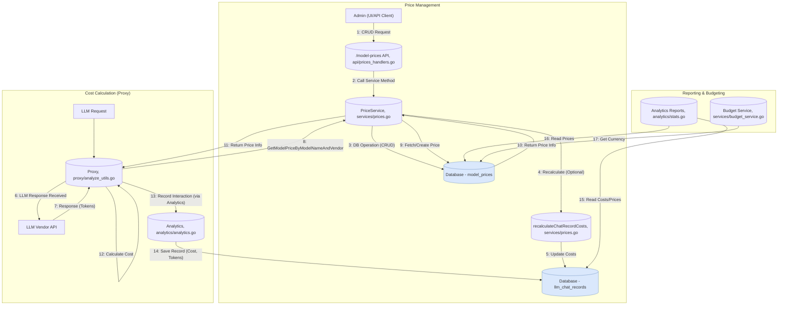

## Model Pricing System

**1. Overview & Purpose**

The Model Pricing system provides the mechanism to define and manage the costs associated with using different Large Language Models (LLMs) within the Midsommar platform. Its primary purpose is to enable accurate cost calculation for LLM interactions, which is crucial for budgeting, analytics, and potential billing.

**Key Objectives:**

*   **Cost Definition:** Allow administrators to define specific costs for various LLM models based on vendor, input tokens, output tokens, and cache usage.
*   **Accurate Tracking:** Ensure that every LLM interaction processed by the **Proxy** has an associated cost calculated based on defined prices.
*   **Data Source for Other Systems:** Provide the foundational cost data used by the **Budget Control System** for spending limits and the **Analytics** module for reporting.
*   **Flexibility:** Handle cases where prices might not be explicitly defined by providing a fallback mechanism.

**User Roles & Interactions:**

*   **Administrator (via User Management):** Manages model prices (CRUD operations) via API endpoints or a potential UI. Can trigger recalculation of historical costs.
*   **Proxy (`proxy/proxy.go`):** Consumes pricing data to calculate the cost of each LLM request/response cycle.
*   **Analytics (`analytics` package):** Uses pricing data when recording LLM interactions (`llm_chat_records`) and generating cost-related reports.
*   **Budget Service (`services/budget_service.go`):** Indirectly uses pricing data (specifically the currency) when formatting budget notifications.

**2. Architecture & Data Flow**

**Core Components & Interactions:**

*   **API Handlers (`api/prices_handlers.go`):** Expose REST endpoints for managing `ModelPrice` entities.
    *   Handles requests for creating, reading, updating, and deleting prices.
    *   Provides endpoints for specific operations like fetching by vendor (`/by-vendor`), getting or creating by name (`/by-name`), and updating with recalculation (`/{id}/recalculate`).
    *   *Dependency:* Calls `PriceService` methods.
*   **Price Service (`services/prices.go`):** Contains the business logic for price management.
    *   Implements CRUD operations interacting with the database.
    *   Includes `GetModelPriceByModelNameAndVendor`: Fetches a price, creating a default 0-cost entry if not found (ensures cost calculation doesn't fail).
    *   Includes `UpdateModelPriceAndRecalculate`: Updates a price and triggers a recalculation of costs in `llm_chat_records`.
    *   *Dependency:* Interacts with the **Database** (`models.ModelPrice`).
*   **Database Model (`models/prices.go`):** Defines the `ModelPrice` struct and database interaction methods (using GORM).
    *   `ModelPrice` struct: `ID`, `ModelName`, `Vendor`, `CPT` (Cost Per output Token), `CPIT` (Cost Per Input Token), `CacheWritePT` (Cost Per Token for cache writes), `CacheReadPT` (Cost Per Token for cache reads), `Currency`.
    *   `idx_model_vendor`: Unique index ensuring only one price entry per model/vendor combination.
    *   Includes `GetOrCreateByModelName` and `GetByModelNameAndVendor` methods for retrieving or creating default entries.
*   **Proxy (`proxy/analyze_utils.go`):** Calculates the cost of LLM interactions.
    *   *Dependency:* Calls `PriceService.GetModelPriceByModelNameAndVendor` after an LLM response is received.
    *   Uses the fetched `CPT`, `CPIT`, `CacheWritePT`, `CacheReadPT` and token counts from the response to calculate the cost.
    *   Stores the calculated cost (scaled by 10000) and currency in the `llm_chat_records` table via the **Analytics** module.
*   **Analytics (`analytics/analytics.go`, `analytics/stats.go`):** Records and reports on costs.
    *   `RecordContentMessage`: Calls `PriceService.GetModelPriceByModelNameAndVendor` to get price details before saving `LLMChatRecord`.
    *   Reporting functions (e.g., `GetTotalCostPerVendorAndModel`): Join `llm_chat_records` with `model_prices` to provide detailed cost breakdowns.
*   **Budget Service (`services/budget_service.go`):**
    *   *Dependency:* Calls `ModelPrice.GetByModelNameAndVendor` to retrieve the currency associated with an LLM for notification formatting.

**Data Flow (Management & Usage):**

**Flow Explanation:**

1.  **Management:** An Admin uses the API (or a UI) to manage prices. API handlers call the `PriceService`. The service interacts with the `model_prices` table in the database. Updating a price can optionally trigger a recalculation of historical costs in `llm_chat_records`.
2.  **Usage (Proxy):** The Proxy handles an LLM request. After receiving the response (with token counts) from the vendor, it calls the `PriceService` to get the relevant `ModelPrice` (fetching or creating a default if needed). It then calculates the cost using the price info and token counts. Finally, it records the interaction details, including the calculated cost, into the `llm_chat_records` table via the Analytics module.
3.  **Consumption:** Analytics reporting functions read from `llm_chat_records` and `model_prices` to generate reports. The Budget Service reads `model_prices` to get currency information for notifications.

**3. Implementation Details**

*   **Price Structure:** Costs are defined per token: `CPIT` (input/prompt), `CPT` (output/completion), `CacheWritePT` (writing to semantic cache), `CacheReadPT` (reading from semantic cache). A `Currency` (e.g., "USD") is also stored.
*   **Cost Calculation Formula (in Proxy):**
    `cost = (CPT * response_tokens) + (CPIT * prompt_tokens) + (CacheWritePT * cache_write_tokens) + (CacheReadPT * cache_read_tokens)`
*   **Unset cache prices (OpenAI, Google AI):** these vendors count cache tokens inside the prompt token count, so the proxy and the Chat-session path (`analytics.RecordContentMessage`) subtract them from `prompt_tokens` (`models.PromptTokensExcludingCache`) and bill them separately. Both store `models.ChatRecordCost`, so a chat-session row and a proxy row for the same usage carry the same tokens and cost. The chat-session path reads usage once per response, from the first choice that carries it: langchaingo copies the full usage onto every choice (Anthropic returns one per content block), so summing choices would bill a text + tool-call turn twice. A `CacheWritePT` or `CacheReadPT` of 0 means "not set" for them and falls back to `CPIT`, so cached tokens are never free just because no cache price was entered (`models.CachePricesFor`, used by the proxy, the recalculation and the analytics cost breakdown). Other vendors report cache tokens apart from the prompt and use their cache prices as set.
*   **Cost Storage:** The calculated cost is multiplied by 10000 and stored as an integer in `llm_chat_records.cost` to maintain precision. It's divided by 10000.0 when used in calculations or displayed.
*   **Fallback Mechanism:** If `GetModelPriceByModelNameAndVendor` doesn't find an exact match for the model name and vendor, it creates a new `ModelPrice` entry in the database with 0.0 for all costs and "USD" as the currency. This prevents cost calculation failures but logs a message indicating the price was missing. The `GetOrCreateByModelName` model method provides similar fallback logic based only on model name.
*   **Recalculation:** The `UpdateModelPriceAndRecalculate` service method and corresponding API endpoint (`PATCH /model-prices/{id}/recalculate`) allow updating a price and retrospectively applying it to all existing `llm_chat_records` for that model/vendor. This is done within a database transaction. Each record is repriced at its stored `price_multiplier` (schema 30; the multiple of list price the gateway billed it at, e.g. 0.5 for batch, 1 at list price), so a batch record stays at its multiplier even through a recalculation via a zero price. A record without one (written before schema 30, edge records, chat-session records) keeps the ratio of its recorded cost to its list cost at the old price (`cost = new_list * cost / old_list`), and the ratio is stored as its multiplier. A record with neither (no old list cost: no price before, or the row was renamed onto this model; or no recorded cost) gets the new list price at 1x. The SQL uses portable `CAST(? AS DOUBLE PRECISION)`, so it also runs on SQLite. It reprices the records the gateway prices with that row: those recorded under the model name, and those whose `requested_model` (the name the caller asked for, stored since schema 29) is the row's name while the vendor reported another, unpriced name (Gemini `gemini-2.0-flash` comes back as `gemini-2.0-flash-001`, OpenAI dates its snapshots; `priceForExchange` falls back to the requested name's price for them). Records written before schema 29, and edge records, have no `requested_model` and match by name only.
*   **Uniqueness:** The database enforces uniqueness on the combination of `model_name` and `vendor`.
*   **API Endpoints:**
    *   `POST /model-prices`: Create a new price. Traffic auto-creates an unpriced (all zero) row for every model and vendor it sees, under both the reported and the requested name; a POST for a model with such a row fills it in (200, the system event is an update, not a create). A POST for a model that already has a priced row is refused with 409, naming the existing row's id; update that row instead. A new model gets 201 as before (`CreateOrFillModelPrice`; gRPC `CreateModelPrice` returns `AlreadyExists` for the conflict).
    *   `GET /model-prices`: Get all prices (paginated).
    *   `GET /model-prices/{id}`: Get a specific price by ID.
    *   `PATCH /model-prices/{id}`: Update a price (no recalculation).
    *   `DELETE /model-prices/{id}`: Delete a price. The delete is permanent (not a soft delete), so the same model and vendor can be priced again; rows that older versions soft-deleted are purged at startup (`models.PurgeSoftDeletedModelPrices`). Traffic for a model without a price row auto-creates an unpriced one (`GetModelPriceByModelNameAndVendor`); concurrent first lookups that race on the insert read the winner's row (`models.IsUniqueViolation`).
    *   `GET /model-prices/by-vendor?vendor=X`: Get prices for a specific vendor.
    *   `GET /model-prices/by-name?model_name=Y`: Get or create a price by model name.
    *   `PATCH /model-prices/{id}/recalculate`: Update a price and recalculate historical costs.
        It emits `system.model_price.updated`, as the standard update does, so edges are flagged for a config push (they price new traffic at the new price once synced) and subscribed plugins are notified. The recalculation reprices the hub's `llm_chat_records` only: an edge's own `analytics_events` and `budget_usages` copies keep the costs they were recorded with.
    *   `POST /model-prices/{id}/backfill`: Price the unpriced history (`BackfillUnpricedHistory`): the records this price prices (same coverage as the recalculation, including requested-name rows) that were recorded at no cost although they used tokens (`cost = 0 AND total_tokens > 0`), at the current price and each record's multiplier, taking the price's currency. Optional body `{"from": "YYYY-MM-DD", "to": "YYYY-MM-DD"}`, inclusive dates in UTC. Records with a cost are not touched. Returns `rows_priced`. Nothing backfills automatically: a first price on a model that has been used for months leaves that history at 0 until an admin backfills it.
    *   `GET /model-prices` sets `meta.unpriced_rows` on each price: the records a backfill would price (`CountUnpricedHistory`, one grouped scan of the unpriced records per page). The prices list shows it as "Unpriced Requests", with a "Backfill unpriced history" row action that takes the optional date range.

**4. Use Cases & Behavior**

*   **Admin Defines Price:** An administrator uses the API (e.g., `POST /model-prices`) to add a new price for "gpt-4" from "openai" with specific CPT, CPIT, etc.
*   **Proxy Calculates Cost:** A user interacts with an application. The request goes through the Proxy. The Proxy calls the LLM vendor, receives a response with token counts, calls `GetModelPriceByModelNameAndVendor` to get the "gpt-4" price, calculates the cost using the formula, and records it in `llm_chat_records`.
*   **Missing Price Encountered:** The Proxy processes a request for a new model "llama-3" from "meta" for which no price exists. `GetModelPriceByModelNameAndVendor` creates a default 0-cost entry for "llama-3"/"meta". The cost is calculated as 0, and a log message is generated.
*   **Admin Corrects Price & Recalculates:** The administrator notices the missing price, adds the correct price for "llama-3" using `POST /model-prices`. They then realize historical costs are wrong and use `PATCH /model-prices/{id}/recalculate` to update the price and fix the costs in `llm_chat_records`.
*   **Analytics Report:** A user views an analytics dashboard which calls an API endpoint (e.g., `/analytics/costs-by-model`). This endpoint uses functions like `analytics.GetTotalCostPerVendorAndModel` which query `llm_chat_records` and join with `model_prices` to show aggregated costs.

**5. Potential Considerations & Future Enhancements**

*   **Currency Handling:** The system currently stores a currency string but assumes calculations and budgets operate consistently. Supporting multi-currency budgets or conversions would require significant changes in **Pricing**, **Budget Control**, and **Analytics**.
*   **Time-Varying Prices:** Prices might change over time. The current recalculation applies the *new* price to *all* historical data. A more sophisticated system might store price validity periods (`valid_from`, `valid_to`) and calculate historical costs based on the price active at the time of the interaction.
*   **User Interface:** While APIs exist, a dedicated UI for managing model prices would improve usability for administrators.
*   **Default Price Management:** The automatic creation of 0-cost defaults is convenient but might hide missing configurations. A stricter mode or better reporting on missing prices could be beneficial.
*   **Regression Suite:** `proxy/pricing_regression_test.go` asserts pricing behaviour against recorded history: a priced multi-vendor history charts the right cost per day and currency, a recalculation keeps each interval (and each row's batch/flex ratio to list price), repeated repricings leave no float drift, and an all-history recalculation reprices only that model within a time bound. Every test runs on SQLite and, when `DATABASE_URL` is a Postgres URL, on Postgres in a schema of its own (CI's Go Postgres Tests job). The normal run uses four weeks of thinned traffic; `make test-pricing` runs the full matrix (180 days, 180k rows recalculated, `PRICING_REGRESSION_FULL=1`) on SQLite and a throwaway postgres:16. `api/pricing_regression_test.go` checks end to end that a recalculation marks in-sync edges Pending through the control server. The budget side is asserted in `grpc/pricing_regression_test.go` (hub budget periods), `microgateway/internal/services/pricing_regression*_test.go` (edge budget periods) and `enterprise/features/budget/pricing_regression_test.go` (spend the budget service reads); `make test-pricing` runs those too. The shared fixtures live there and the diagnostics below reuse them.
*   **Stress Diagnostics:** `proxy/pricing_stress_diag_test.go` (build tag `pricing_stress`) records months of synthetic multi-vendor traffic, applies price changes (first price on unpriced history, standard update vs recalculate, requested vs vendor-reported model names, delete and re-create, recalculation through a zero price, mixed currencies) and logs how the per-day cost chart comes out. `enterprise/features/budget/pricing_stress_diag_test.go` (tags `enterprise,pricing_stress`) logs the budget service's spend after a recalculation and budget period starts for anchor days 29-31. They report rather than assert, and are not run in CI; run them before a release when pricing or budgets changed. Run commands are in each file's header.
*   **Bulk Operations:** APIs for bulk creation/update/deletion of prices could be useful for managing large numbers of models. (Note: Basic bulk methods exist in `models/prices.go` but aren't fully exposed via dedicated API handlers in the provided snippets).