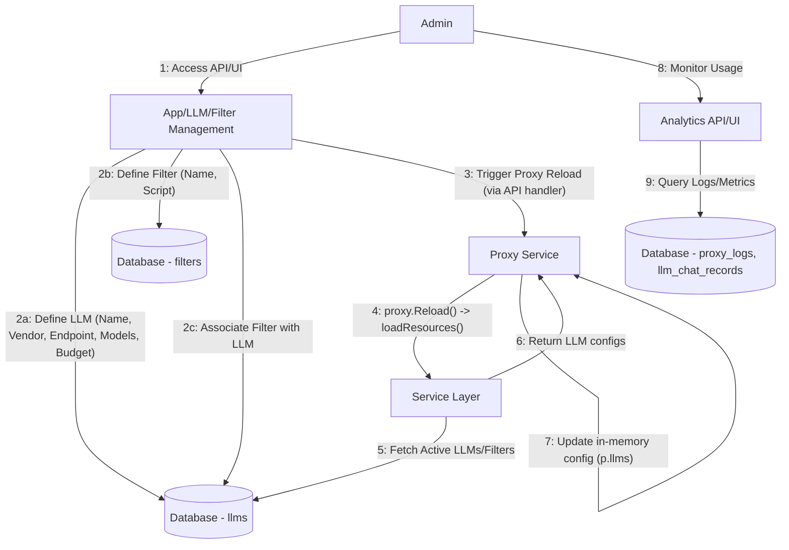
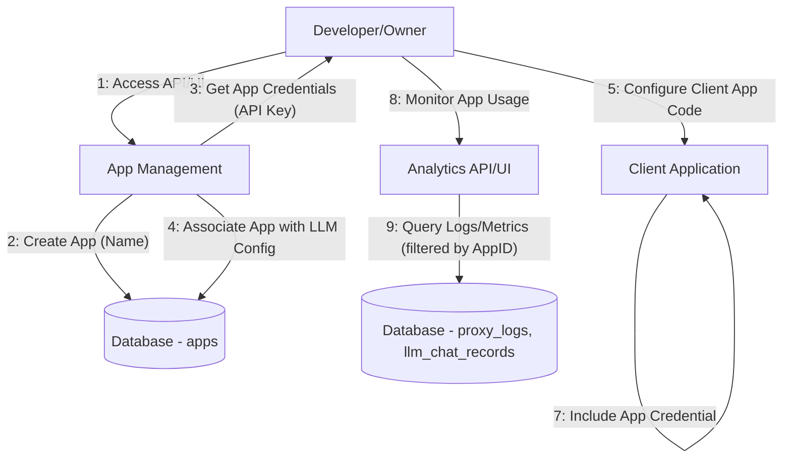
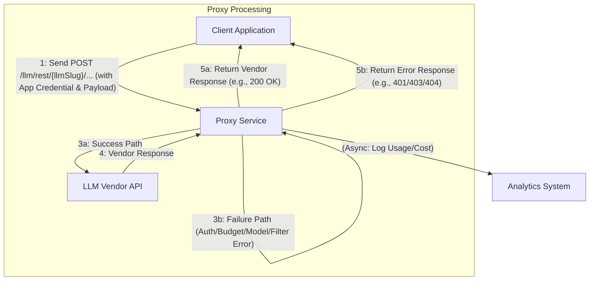

## LLM Proxy System

**1. Overview & Purpose**

The LLM Proxy System acts as a centralized, secure, and observable gateway for all interactions between internal applications (Apps) and external Large Language Model (LLM) providers. It intercepts requests directed at specific LLM configurations, enforces various policies (authentication, model restrictions, budget limits, custom filters), and forwards valid requests to the appropriate vendor API endpoint, while logging usage for analytics and cost tracking.

**Key Objectives:**

*   **Centralized Access:** Provide a single point of entry (`/llm/rest/{llmSlug}/...`, `/llm/stream/{llmSlug}/...`) for applications to consume different LLMs without needing direct vendor credentials or endpoints.
*   **Authentication & Authorization:** Verify application credentials (`App` token) before allowing access to any LLM resource using the **Credential Validator**.
*   **Model Control:** Enforce which specific models within a vendor's offering an application is allowed to use, based on the LLM configuration (`llm.AllowedModels`) using the **Model Validator**.
*   **Policy Enforcement (Filters):** Apply custom request filtering rules defined per LLM configuration (`llm.Filters`) to modify or reject requests based on content or other criteria before they reach the vendor. Uses the **Scripting** engine.
*   **Budget Enforcement:** Integrate with the **Budget Control System** (`BudgetService`) to check App and LLM budgets before forwarding requests and trigger usage updates after completion.
*   **Vendor Abstraction:** Hide vendor-specific API details (authentication, request/response formats, endpoints) from consuming applications using the **Switches** and **Vendor** packages.
*   **Analytics & Observability:** Log detailed records of each proxied request (`ProxyLog`) and the corresponding LLM interaction, including token counts and calculated costs (`LLMChatRecord`), feeding data into the **Analytics** system.
*   **Streaming Support:** Handle real-time streaming responses from LLMs that support it.
*   **Dynamic Configuration:** Allow runtime reloading of LLM configurations (`proxy.Reload()`) triggered by API updates without restarting the service.

**User Roles & Interactions:**

*   **Administrator (Admin):**
    *   **Configuration:** Uses the Midsommar API/UI (**App/LLM/Filter Management**) to:
        *   Define LLM providers (`llms` table), including vendor type, API endpoint, credentials (if applicable, though often App-specific), allowed models, budget settings, and associated Filters.
            *   The API endpoint may be configured with or without a version segment and with or without a proxy prefix (`https://api.anthropic.com`, `https://api.anthropic.com/v1`, `https://gw/anthropic/v1`). The proxy composes the vendor URL from the endpoint path and the request path with their overlap removed (`proxy/upstream_path.go`), so every entry point (unified router, `/ai/` bridge, `/llm/call/` passthrough, streaming or not) reaches the same vendor path. The Anthropic driver used by chat appends `/v1` itself when the endpoint has no version segment (`vendors/anthropic.DriverBaseURL`).
        *   Create and manage Filters (`filters` table) containing JavaScript logic.
        *   Manage Applications (`apps` table) and potentially their credentials/associations.
        *   Manage Model Pricing (`model_prices` table) via **Pricing** features.
    *   **Monitoring:** Uses the Midsommar API/UI (**Analytics**) to view aggregated usage, costs, budget status, and proxy logs. Receives budget/system notifications via **Notification Service**.
*   **AI Developer/App Owner (Dev):**
    *   **Configuration:** Uses the Midsommar API/UI (**App Management**) to:
        *   Create and manage their Applications (`apps` table).
        *   Obtain credentials (e.g., API keys) for their Apps.
        *   Associate their Apps with specific LLM configurations.
    *   **Integration:** Configures their client application code to send requests to the appropriate Midsommar Proxy endpoint (`/llm/.../{llmSlug}/...`), including the App's credential for authentication.
    *   **Monitoring:** Uses the Midsommar API/UI (**Analytics**) to monitor their specific App's usage, costs, and budget status. Receives App-specific budget notifications via **Notification Service**.
*   **Application (Client):**
    *   **Interaction:** An automated system (code written by the Dev) that sends HTTP requests (POST) to the Midsommar Proxy endpoints (`/llm/rest/...` or `/llm/stream/...`).
    *   **Authentication:** Includes its unique credential (e.g., API key) in the request headers as required by the target vendor's format (e.g., `Authorization: Bearer <app_key>`).
    *   **Request:** Specifies the target LLM via the `{llmSlug}` in the URL and includes the vendor-specific payload (including the desired model) in the request body.
    *   **Response:** Receives either the proxied response from the upstream LLM vendor or an HTTP error from the Midsommar Proxy (e.g., 401 Unauthorized, 403 Forbidden for budget/model/filter violations, 404 Not Found, 5xx for internal/upstream errors).

*(Note: This system primarily focuses on pass-through proxying. A separate OpenAI Translation Layer exists at `/v1/chat/completions` which adapts OpenAI-formatted requests to various backend vendors.)*

**2. Architecture & Data Flow**

**Core Components & Interactions:** (Components remain the same as previous spec)

*   **Proxy (`proxy/proxy.go`)**
*   **CredentialValidator (`proxy/credential_validator.go`)**
*   **ModelValidator (`proxy/model_validator.go`)**
*   **Service (`services/service.go`)**
*   **BudgetService (`services/budget_service.go`)**
*   **Switches (`switches/switches.go`)**
*   **Vendor Implementations (`vendors/{vendor}/{vendor}.go`)**
*   **Analytics (`analytics/analytics.go`)**
*   **Scripting (`scripting/scripting.go`)**
*   **Database (`models/`)**

**Data Flow (Simplified REST Request):**

```mermaid
flowchart LR
    A["Client Request (/llm/rest/{llmSlug}/...)"] --> B{"Proxy Router"};
    subgraph "Middleware Chain"
        B --> C["CredentialValidator"];
        C -- "1: Validate Creds (via Service)" --> D[("Database - apps")];
        C -- "Context: App" --> E["ModelValidator"];
        E -- "2: Extract/Validate Model (vs llm.AllowedModels)" --> F[("Database - llms")];
        E -- "Context: Model Name" --> G["handleLLMRequest"];
    end
    subgraph "Request Handling"
        G -- "3: CheckBudget(app, llm)" --> H["BudgetService"];
        H -- "4a: Budget OK" --> I{"Screen Request"};
        H -- "4b: Budget Exceeded" --> J["Return HTTP 403"];
        I -- "5: Apply llm.Filters (Scripting)" --> K{"Vendor Screen"};
        K -- "6: Call vendor.ProxyScreenRequest" --> L{"Set Auth"};
        L -- "7: Call vendor.ProxySetAuthHeader" --> M["Forward Request (ReverseProxy)"];
    end
    M --> N["LLM Vendor API"];
    N -- "8: Vendor Response" --> M;
    M -- "9: Capture Response" --> G;
    G -- "10: Analyze Async" --> P(("analyzeResponse Goroutine"));
    subgraph "Async Analysis"
        P -- "11: Log ProxyLog" --> Q["Analytics"];
        P -- "12: switches.AnalyzeResponse" --> R{"Vendor Analyze"};
        R -- "13: vendor.AnalyzeResponse" --> S["Parse Tokens"];
        S -- "ITokenResponse" --> T["AnalyzeCompletionResponse"];
        T -- "14: Get Pricing" --> U[("Database - model_prices")];
        T -- "15: Calculate Cost" --> T;
        T -- "16: Log LLMChatRecord" --> Q;
        T -- "17: Trigger Budget Update" --> H;
    end
    G -- "18: Return Response to Client" --> A;

    style J fill:#f9f,stroke:#333,stroke-width:2px
```

**User Role Flows:**

**Administrator Flow (Configuration Example):**

**Developer/Owner Flow (Integration Example):**

**Application (Client) Flow (Request Example):**

**3. Implementation Details**

*   **Endpoints:**
    *   `POST /llm/rest/{llmSlug}/{rest:.*}`: For standard REST LLM API calls.
    *   `POST /llm/stream/{llmSlug}/{rest:.*}`: For streaming LLM API calls.
    *   `{llmSlug}`: URL slug generated from the `llm.Name` configured in the database.
    *   `{rest:.*}`: Captures the remaining path to be forwarded to the vendor API.
    *   **Native API extensions:** a native route (`/llm/{rest|stream|call}/{llmSlug}/...`) also accepts the non-POST methods of the SDK-specific operations a vendor declares through `pkg/nativeapi`. Anthropic Message Batches is the first: create, list, retrieve, cancel, results and delete under `/v1/messages/batches`. The native route is matched before the legacy routes, on the exact method and canonical vendor path. Anything it does not declare stays on the legacy chain unchanged (`POST /v1/messages` included, and a GET elsewhere is still 405). Batch IDs are signed per App and LLM; filters run per batch item and per results line; usage is accounted once, at the batch price, from the results. See [NativeAPIExtensions.md](NativeAPIExtensions.md).
    *   **Anthropic Messages bridge (Bedrock only):** `POST /anthropic/{llmSlug}/v1/messages` translates Anthropic Messages to Bedrock Converse (`proxy/anthropic_bedrock_translator.go`). `GET /anthropic/{llmSlug}/v1/models` (`handleAnthropicListModels`, `proxy/anthropic_bedrock_discovery.go`) answers Claude Code's gateway model discovery (`CLAUDE_CODE_ENABLE_GATEWAY_MODEL_DISCOVERY=1`) with `{"data":[...],"has_more":false}`. It lists one entry: the LLM's default model id unchanged, with `display_name` `<LLM name> — <model id>` (the id alone when the LLM has no name). The list is empty when there is no default model or `allowed_models` refuses it. Both routes sit behind the same `CredentialValidator` middleware, so an unknown or ungranted slug is 403 before the handler runs. Behind that, the handler answers 400 for a non-Bedrock LLM (and 404 for a slug missing from `p.llms`), as `/v1/messages` does. The connection checks and model choice mirror `handleAnthropicMessagesEntry` and `resolveAnthropicModelID` and must stay in step with them. The list endpoint calls no model: it spends no budget, runs no filters and records no usage or analytics.
    *   **Tool Proxying:**
        *   `GET/POST/PUT/DELETE /tools/{toolSlug}`: Direct tool operation calls with simplified request format.
        *   **MCP (Model Context Protocol) Support:**
            *   `POST /tools/{toolSlug}/mcp`: StreamableHTTP transport for modern MCP clients.
            *   `GET /tools/{toolSlug}/mcp/sse`: SSE transport endpoint for legacy MCP clients.
            *   `POST /tools/{toolSlug}/mcp/message`: Message endpoint for legacy MCP clients.
        *   REST and MCP are per-tool **access methods** (`features/Tools.md` section 5a). A method that is switched off answers 403 after the App ACL has passed; REST enforces the tool's operation whitelist as MCP does; the lookup by slug resolves active tools only.
*   **Configuration:** LLM endpoints, credentials (API keys, often App-specific), allowed models, filters, and vendor types are stored in the `llms` table, managed via **LLM Management** API/UI. Active LLMs are loaded into the proxy's memory map (`p.llms`) by `loadResources`. Filters are stored in the `filters` table. Pricing in `model_prices`.
*   **Authentication:** Relies on `CredentialValidator` middleware. Expects credentials in the format required by the *target vendor* (e.g., `Authorization: Bearer <app_key>` for OpenAI-like vendors, `x-api-key: <app_key>` for Anthropic). The validator checks this `<app_key>` against the `apps` table via the `service`.
*   **Auth plugins (microgateway):** every endpoint has an ordered list of auth plugins: an LLM's attached plugins with the auth hook, and for datasources, tools, model and semantic routers and custom-endpoint plugins a list of their own (`endpoint_auth_plugins`, Studio `models/endpoint_auth_plugin.go`, edge `database.EndpointAuthPlugin`; set with `PUT /api/v1/{datasources|tools|model-routers|semantic-routers|plugins}/{id}/auth-plugins`). The snapshot carries the lists as `auth_plugin_ids` on each config message and the LLM order as `LLMConfig.plugin_ids`; only active plugins are listed, so deactivating one in Studio drops it off as it drops off an LLM.
    *   The validator resolves the endpoint the path addresses (`authTarget`: `/ai/{slug}` is the LLM, else the router) and calls the `CustomAuth` hook (`proxy.AuthHooks`) after the Studio OAuth branch on both the Bearer and API-key paths. An endpoint with auth plugins is authenticated by them alone, in order, first to authenticate wins (`microgateway/internal/api/auth_hooks.go` `pluginAuthenticator`, `plugins.GetAuthPlugins`/`CallAuth`, 5 s per plugin); all refuse → 401, and app keys are not tried. None loadable → 503, never a fall back to app keys. An authenticated answer without a valid app id is a rejection (it used to become app 1). No list → app keys as before, and no plugin sees the traffic.
    *   `/plugins/{slug}/` custom endpoints with `require_auth` use the endpoint plugin's list in place of `ValidateAPIToken` when it has one, and require the App to be active; the subject and claims reach the endpoint plugin on `EndpointRequest`.
    *   Every branch records a `proxy.AuthIdentity` (`pkg/authidentity.Identity`: app, method `app_key`/`oauth`/`plugin`, the plugin, the subject and claims a plugin returned) on the request context; post-auth plugins get the subject as `UserID` and the claims as `AuthClaims`.
    *   `analytics.RecordProxyLog`/`RecordExchange`/`RecordChatRecord` stamp the subject and the `auth_actor` claim as `on_behalf_of` and `acting_agent` on the proxy log and chat record (audit only; `user_id` stays the App owner). On an edge they ride the analytics row (`analytics_events`), the plugin `AnalyticsData` and the pulse's `AnalyticsEvent` (fields 40, 41) to the hub's `proxy_logs` and `llm_chat_records` (schema v5), and show as For/Agent under a proxy log's timestamp in the admin UI.
    *   The `/ai/` loopback hands the outer hop's identity to the inner hop (`X-Tyk-Auth-*` headers, trusted only with the per-process failover token over the loopback, stripped before egress). The endpoint the caller addressed decides how it authenticates; the inner hop does not ask the picked LLM's plugins again. Its ACL still runs.
    *   A plugin on several LLMs is sent once with every LLM id. It used to go out once per LLM with the same id, which failed the edge's whole sync; the edge now also tolerates the old shape. Per-LLM config overrides survive on the edge only for a plugin on one LLM.
    *   An edge runs an LLM's plugins (pre_auth, post_auth, response hooks) in the order set in Studio: `GRPCProvider.GetPluginsForLLM` sorts them by the LLM's `plugin_ids`, which the hub sends by `order_index` (`snapshotPluginAttachments`), as a standalone gateway's `DatabaseProvider` orders them. It used to keep the snapshot's plugin-id order, so the chain ran in install order (midsommar-clean-701). A plugin the list does not name goes last; a microgateway serving its own snapshot now also sends `plugin_ids` by `order_index`.
    *   A pre_auth or post_auth plugin's refusal (status 400 or over) of a native Bedrock runtime call (`/model/{id}/…`, the bridges' loopback included; `isBedrockRuntimeCall`) goes out in the AWS JSON protocol's shape, unless the plugin set `X-Amzn-ErrorType` itself (`writeBlockedPluginResponse`, 8xf.30): `X-Amzn-ErrorType` by status (`bedrockVendor.ErrorType`: 401/403 `AccessDeniedException`, 429 `ThrottlingException`, 404, 408, 503 and other 4xx/5xx likewise) and `{"message": …}` with the plugin's own message (`bedrockVendor.ErrorBody` reads `{"error":{"message"}}`, `{"error":"…"}`, `{"message"}` or the text). An AWS SDK then raises the typed error with the plugin's message, where it reported an unknown error without it; the bridges read the message from it as well. A 2xx answer (a cache hit) and Bedrock's OpenAI-compatible paths are left as the plugin wrote them.
    *   Studio's embedded gateway runs no gateway plugins, so these lists apply on edges only.
*   **Request filter format:** `pkg/requestformat.For(vendor, method, path, endpoint)` names the wire shape filters, guardrails and buffered responses read a native `/llm/` body in: the vendor's own, `openai_decisions`/`systemone` for a decision path, or the format `requestformat.ChainFormats` lists for the operation's canonical path (OpenAI `/v1/responses*` → `openai_responses`; embeddings, completions, moderations → `openai_input`). `requestFilterFormatFor` calls it with `switches.UpstreamEndpoint(llm)`; gateway plugins call it with `LLMInfo.Endpoint`, so both agree. It depends only on `pkg/decisions`. `ChainFormats` repeats the vendors' chain-hook `FilterFormat`s; `TestRequestFormatChainFormatsMatchVendorSpecs` keeps them equal. The bridges (`/ai/`, `/v1`, routers, `/anthropic/`) take OpenAI or Anthropic bodies and re-enter on `/llm/call/` with the vendor-native body, which post_auth and the filters read in that vendor's format (a Converse body for Bedrock since 8xf.12; before, the Bedrock bridges screened the client's body as `openai`/`anthropic` themselves and ran no post_auth).
*   **Model, stream and usage readers:** `pkg/requestformat.Model`, `IsStreaming` and `ParseUsage` (re-exported to plugins as `plugin_sdk.RequestModel`, `IsStreamingRequest` and `ResponseUsage`) read the model, streaming flag and token usage of an exchange per vendor: Bedrock's `/model/{modelId}/` path (escaped ARNs unescaped) and `converse-stream`/`invoke-with-response-stream` operations, Google's `models/{m}:` path and `:streamGenerateContent`, otherwise body `model`/`stream`; usage from OpenAI (Chat and Responses), Anthropic, Google, Bedrock Converse (camelCase, including cache tokens and raw eventstream frames) and Ollama, REST or whole-stream. Pure functions, no host call, so plugins built with them run on older hosts.
*   **Model and stream metadata:** the hosts put `proxy.ExchangeMetadata(vendor, escapedPath, body)` (`model`, absent when the request names none, and `stream`, `"true"`/`"false"`) into `PluginContext.Metadata` for every vendor: the edge's post_auth hook (`microgateway/internal/api/auth_hooks.go`, from the body it hands the plugins) and every response hook phase (`responsePluginContext`, from what the `/llm/rest/` and `/llm/stream/` handlers kept on the context with `withExchangeMetadata` once the filters ran). A convenience only, set from 2.3: published plugins read the request with the helpers above, so they also run on older hosts (`docs/site/docs/plugins-sdk.md`).
*   **Plugin message size:** each hook call is one gRPC message (body plus headers and context). `pkg/pluginlimits` sets the limit: 64 MiB, or `PLUGIN_GRPC_MAX_MSG_BYTES`. Both SDKs serve with `pluginlimits.GRPCServer` instead of go-plugin's `DefaultGRPCServer` (gRPC's 4 MiB), and `pkg/pluginenv` passes the variable to plugin processes; go-plugin's client side already allows `math.MaxInt32`. The hosts' brokered service-API servers (Studio `PluginBrokerServerOptions`, edge `grpc.go`) take `pluginlimits.HostServiceServerOptions()`, a fixed 8 MiB, so the body limit does not raise what a plugin can push into the host (eac.44). On the edge, `readBodyWithoutConsuming` reads at most the limit (a larger body is `pluginlimits.ErrRequestTooLarge`), and `ExecutePluginChain`/`CallAuth` check `proto.Size` against it before calling (`pluginlimits.CheckSize`) (eac.43). A plugin built on an older SDK keeps 4 MiB: the edge wraps its refusal (`ResourceExhausted`, "larger than max") as a `pluginlimits.TooLargeError` naming the plugin and size. Any of these makes `pre_auth`/`post_auth` answer `413` without forwarding (`respondPluginChainError`), and auth plugins `413` when no other plugin answered (`pluginAuth`); the client message (`pluginlimits.ClientMessage`) gives the size, not the plugin, which is logged. Response hooks log it and fail open as for any hook error.
*   **Authorization (resource ACL):** After *any* authentication branch succeeds (API key, Bearer app secret, auth plugin, or the `/ai/` loopback hand-off), the target the path names is checked against the app by `targetAllowed` in `proxy/credential_validator.go`, the one implementation of the rule on both the Studio embedded gateway and the edge:
    *   `/llm/{rest|stream|call}/{slug}`: the app holds the LLM, or inherits it as a failover rung of an LLM it holds (`failoverGrantsAccess`, trusted only with the per-process loopback token).
    *   `/ai/{slug}`, `/anthropic/{slug}` and the unified `/v1` (which rewrites to `/ai/{slug}` before auth): the app holds the LLM. Both hops of these bridges are checked, Bedrock's included (it used to be served from the outer hop, which was its only check).
    *   `/datasource/{slug}`: the app holds the datasource. Tools keep their own ACL (`authorizeToolAccess`).
    *   Unknown and ungranted both answer 403 with the same wording ("... not found or not supported by your access rights"), so slugs cannot be enumerated; bad or inactive credentials stay 401. Until this check existed only the API-key branch applied it, so any active app's Bearer secret could call any active LLM by naming it. The API-key branch (`x-api-key`, a non-Bearer `Authorization`) answered 401 for an ungranted LLM, route or datasource until 2026-09-27; it now gives the same 403 as every other branch. Tools still answer 401 "invalid credential" whether missing or ungranted.
*   **Authentication status codes** (every branch, both planes):
    *   `401`: the credential is unknown, or was rejected (an inactive credential, or the control plane said the token is invalid).
    *   `403 "app is inactive"`: the credential's App has its live switch off. On an edge the control plane names this case in its rejection (`services.AppInactiveMessage`), so the edge answers as the embedded gateway does. A config push can remove an inactive App from an edge while its token is still cached; the budget check then reports `services.ErrAppInactive` and the gateway answers the same `403 "app is inactive"` (not `Budget limit exceeded`, and not counted as a budget block). Depending on which check notices first, such a request can instead get `401` until the cached token expires.
    *   `403 "... not found or not supported by your access rights"`: authenticated, but the App is not granted the target.
    *   `503` with `Retry-After` and an OpenAI-shaped body (`code: credential_check_unavailable`): the credential could not be checked, for example an edge whose control plane is unreachable or failing, past the token cache's TTL and stale grace. The edge marks these errors `services.ErrCredentialCheckUnavailable`; before 2026-09-27 they answered 401, which clients read as a bad key and do not retry.
*   **Model Validation:** `ModelValidator` checks the `model` field within the request *body* against the `llm.AllowedModels` string array. Vendor-specific extractors handle different request body structures.
*   **Filtering:** LLM-specific request filters (`llm.Filters` with `response_filter=false`) are executed by `runRequestFilters` *before* the request is forwarded. Filters are Tengo scripts stored in the `filters` table. Every entry point runs them:
    *   `/llm/rest/` and `/llm/stream/` (native pass-through) via `screenProxyRequestByVendor`, using the LLM vendor's own message extractor.
    *   `/ai/{route}/v1/chat/completions`, the unified router and `/anthropic/{route}/v1/messages` on the internal `/llm/call/` loopback hop, against the vendor-native body the bridge translated (a Converse body for Bedrock). A block is a 400 that does not fail over to the next rung. The Bedrock bridges used to screen the client's OpenAI or Anthropic body themselves (`bedrockScreenRequest`, `anthropicScreenRequest`, removed in 8xf.12); the body screened is now the one sent, so a body whose keys parsers read differently is screened as decoded rather than refused.
*   **Loopback response headers:** On the `/ai/` bridge and the unified `/v1`, the SDK driver consumes the inner `/llm/call/` response, so headers set there would otherwise never reach the client. `InternalRoutingTransport` captures the plugin headers on `relayedLoopbackHeaders` (`X-Cache`/`X-Cache-*`, which cache plugins set on hits and misses, the Prompt Compressor's `X-Tyk-Compression`/`X-Tyk-Compression-*`, the load balancer's `X-LB-*` and the rate limiter's `X-RateLimit-*` (8xf.29; a vendor's own `x-ratelimit-*` comes along, as it describes the same caller's quota); an exact list, since other `X-Tyk-` headers are internal and the failover token a per-process secret) from the served rung's 2xx loopback response (`loopbackRelay` in `proxy/internal_transport.go`), and the translator writes them on the outer response: before `WriteHeader` when buffered, and with the first frame when streaming. The caps are 32 values and 8 KiB. A refusal's relayed headers are kept too (`captureFailure`, `attemptFailure.headers`) and go out on the client's error response, so a rate limiter's 429 keeps its `X-RateLimit-*` retry hint (`respondAttemptFailure`, `failStreamAttempt` before the first frame, `respondAnthropicAttemptFailure`). Other vendor and transport headers are deliberately not relayed, because they describe the loopback response, not the translated one. A failed rung's headers never leak onto a rung that served.
*   **Client instructions to gateway plugins:** `X-Tyk-Compression` (and `X-Tyk-Compression-*`) on a request is for the plugins, never the vendor (`proxy/compression_headers.go`). `withClientLoopbackHeaders` copies the client's `X-Tyk-Compression` onto the `/ai/`, `/v1`, router and decisions loopback request (the SDK driver copies no client header otherwise), so the plugin on `/llm/call/` sees it; `stripFailoverHeaders` removes both forms at the two exits that forward client headers (the REST director and the streaming upstream request). The other exits forward no client header unlisted: native operations send only their `HeaderAllow` list, and the native Bedrock stream builds its own headers (the Bedrock bridges take the loopback, so the REST director or that stream is their exit). `TestCompressionHeader_ReachesPluginsNeverTheVendor` covers `/llm/rest`, `/llm/stream`, `/ai/` buffered and streaming, a model router and the unified `/v1`.
*   **Response hooks on streams:** `handleStreamingLLMRequest` runs the response hooks' header phase (`executeStreamingHeaderHooks`) after copying the upstream headers and before `WriteHeader`, with the buffered contract (the hooks return the full set): changed or added keys are set, dropped keys deleted, untouched keys keep all their values, and `Content-Type`, `Content-Length` and `Transfer-Encoding` never change. It runs in a goroutine under `streamHeaderHookTimeout` (2 s); an error, panic or timeout sends the upstream headers. Response-phase plugin contexts (`responsePluginContext`, buffered, streaming and stream-complete) carry `LLMSlug = slug.Make(llm.Name)`, the route slug post_auth gets, not the display name.
*   **`OnStreamComplete` on every stream exit (bpu):** once the upstream request is made, `handleStreamingLLMRequest` and the native Bedrock stream send exactly one `OnStreamComplete` per request (`streamCompletion`, `proxy/stream_completion.go`), however the stream ends: completed (the upstream status), an upstream error response (its status and body), a response filter, guardrail or held tool-call block (`400`, as analytics records it, with what was accumulated), a transport error with no response (the `502`/`504` the client got) and an upstream that breaks off mid-stream (`502`). Plugins that hold per-request state from post_auth (the load balancer's active connections, the rate limiter's concurrent slots, the caches' pending entries) release it there; a stream that ended any way but completed carries a non-2xx status, so caches never store it. Exits before the upstream request (budget, request filters, configuration errors) still send none (midsommar-clean-8xf.33).
*   **Loopback refusals:** the drivers keep little of a refused loopback response (the OpenAI and Anthropic drivers keep the envelope's message behind "API returned unexpected status code"; Google's keeps no message at all, so a guardrail block on a Google AI route reached the client as `googleapi: Error 400:`). `InternalRoutingTransport` therefore also keeps the status and the first 16 KiB of the body of a 4xx/5xx loopback response (`loopbackRelay.captureFailure`, restored so the driver still reads all of it), and `attemptFailure.withLoopback` turns it into the failure's reason and status (`parseLoopbackError` in `proxy/oai_error_contract.go` reads the OpenAI, Anthropic and Google envelopes, the pass-through's own `ErrorResponse` and the edge's `{"error": message}` (its plugin-chain refusals, such as a body over the plugins' size limit; 8xf.36); a 5xx `ErrorResponse` keeps its message but not its detail, which is our internals, and a gateway 413 gets the code `request_too_large`, not OpenAI's `context_length_exceeded`). The client gets that error in the OpenAI envelope (`respondAttemptFailure`, `failStreamAttempt`) on the buffered and streaming paths alike; the driver's error string is only the fallback when the body is not an error we can read. A later loopback response (a driver retry) or a transport error clears a kept refusal.
*   **Budget refusals:** both pass-through handlers answer "Budget limit exceeded" (the streaming handler said "... for streaming", also on the non-streaming requests the `/llm/call/` hop routes to it). Direct callers keep the `ErrorResponse` body; the internal hop gets an OpenAI envelope (`respondBudgetDenial`, `budgetDenialError`) with `code: budget_exceeded` and the reason (`Budget limit exceeded: app monthly budget is 0`), or `code: budget_check_unavailable` and no detail for a check that could not run (503). An App the budget check finds inactive or gone (`services.ErrAppInactive`) gets `code: app_inactive` and the message `app is inactive`. Bedrock rungs report the same error, from the same inner-hop check (they checked the budget on the outer hop before 8xf.12).
*   **Upstream transport failures:** a vendor that cannot be reached (refused, reset, EOF) answers 502 and a timeout 504 on every path, and each leaves one analytics row with that status. The streaming handler, which `/ai/` and the unified `/v1` reach through `/llm/call/`, recorded none; `/llm/rest/` has recorded them since its `ErrorHandler` (#629). On the loopback hop a cancelled upstream call is recorded as 504 (`loopbackAwareTransportStatus`): the outer hop's attempts run on contexts detached from its client, so only the attempt deadline cancels a loopback request, and the outer hop answers 504.
*   **Upstream override:** a post_auth plugin can set `upstream_override` in its context updates (a load balancer's pick of endpoint). `/llm/rest/` and `/llm/stream/` send the request there in place of the LLM's endpoint, the native Bedrock stream included (`handleBedrockStreamingProxy`, which ignored it before); the override passes the same SSRF check. Bedrock signs every request for the region of the host it goes to (`bedrockVendor.SigningRegion`: `bedrock-runtime.{region}.…` or `bedrock-mantle.{region}.…`), so an override into another region is accepted by AWS (it used to be signed for the LLM's own region, a 403). A host that names no region (a VPC endpoint, a proxy) is signed for the LLM's region (its endpoint's, else `metadata.aws_region`). `/llm/rest/` signs in its transport (`sigV4Transport`), after `httputil.ReverseProxy` has set its headers (#825), and the forwarding headers proxies change in transit (`X-Forwarded-For`, `X-Forwarded-Host/-Proto/-Port`, `Forwarded`, `X-Real-Ip`, `Via`) go out unsigned (`bedrockVendor.unsignedHeaders`): AWS's front end appends the caller's address to `X-Forwarded-For` before it checks, so signing it made real AWS refuse every non-streaming call with 403 SignatureDoesNotMatch (8xf.39). On the native stream an override may also be a bare region, as the LLM's endpoint may.
*   **Bedrock bridges loop back (8xf.12):** `/ai/{slug}`, the unified `/v1`, routers and `/anthropic/{slug}` reach a Bedrock LLM as every other vendor: the bridge translates (OpenAI or Anthropic to Converse and back, the SSE pumps unchanged) and its AWS SDK client calls the proxy's own `/llm/call/{slug}` (`newBedrockLoopbackClient`, `proxy/bedrock_loopback.go`): `BaseEndpoint` from `getInternalLLMBaseURL`, the shared `InternalRoutingTransport` with the loopback headers (auth hand-off, failover and router markers, trace span, the client's `X-Tyk-Compression`), anonymous credentials (no SigV4 on the hop; the SDK is told `noAuth`, so `AWS_BEARER_TOKEN_BEDROCK` cannot pick bearer auth), no retries (the waterfall owns them), built per request. The inner hop runs the hand-off, pre_auth/post_auth plugins, model validation, budget, request filters, SigV4 with the LLM's keys, response hooks, response filters and analytics on the Converse body or event stream, exactly once.
    *   **What came off the bridges:** their budget check, request screening, buffered and stream response filters (`stream_screen.go`, now deleted), ProxyLog/chat-record recorders, Bedrock-only request metrics and agent-trace capture. The outer hop records the logical call (`captureOuterCall`, `captureOuterCallAs` with the Anthropic format for `/anthropic/`) and the inner hop its attempt, as for other vendors. A buffered call's ProxyLog `ModelName` is now the LLM's name, as on every vendor's `/llm/rest/` row (the bridge wrote the model id; the chat record still has it); the native stream's rows keep the model id.
    *   **Failures:** an inner-hop refusal (filter or plugin block, budget, the vendor's error) is read from the relay (`withLoopback`) into the bridge's envelope: OpenAI on `/ai/` (4xx never fails over; 5xx/429 do, Bedrock↔OpenAI both ways), Anthropic on `/anthropic/` (`respondAnthropicAttemptFailure`), with the inner status, now also for a stream that has not opened (it used to be a 200 with one error event). A 2xx that is not a Converse answer (a plugin that blocks with 200 and its own body) is a 502 with the body's message, never an empty answer (`converseCheckClient`). A stream the inner hop's filters blocked ends with its `hdrStreamBlocked` trailer, read after the SDK stream closes: `failStreamBlocked` on `/ai/`, an Anthropic `error` event on `/anthropic/`. Plugin headers (`X-Cache*`, `X-Tyk-Compression*`) are relayed buffered and streaming.
    *   **Analytics parity:** `responses.BedrockConverseResponse` reads `cacheReadInputTokens`/`cacheWriteInputTokens`, so `/llm/rest/` Bedrock rows price cache tokens as the bridge recorder did; the model comes from the path (`model_name`). The native stream records a failed upstream call (vendor 4xx/5xx, transport 502/504) as a ProxyLog row (`recordBedrockFailedAttempt`), as the bridges did for their rungs.
    *   **Runtime path on `/llm/rest/`:** a Bedrock runtime call (`/model/{id}/…`) goes to `bedrockVendor.RuntimeBaseURL` (an endpoint's trailing `/v1` dropped, a bare region expanded, no endpoint means `metadata.aws_region`), as the SDK client and the native stream did; other paths (the OpenAI-compatible `/v1/chat/completions`) keep the configured endpoint.
*   **Native Bedrock on `/llm/`:** the inner hop the Bedrock bridges loop back to (8xf.10).
    *   **Model IDs:** the AWS SDKs escape the model ID, so an ARN or inference profile arrives as `arn%3Aaws%3A…%2F…`. `ExtractBedrockModelIDFromPath` (model validation, the native stream) reads it from `r.URL.EscapedPath()` through `requestformat.Model` and gets the whole ARN; it used to stop at the ARN's `/`. The `/llm/call/` → `/llm/rest|stream/` rewrites (`rewriteLLMPathPrefix`) and the `/llm/rest/` director keep the caller's escaping (`RawPath`), so the ARN reaches AWS as one segment and SigV4 signs the path that is sent.
    *   **Region-only endpoint:** an LLM (or `upstream_override`) whose endpoint is a bare region (`us-east-1`) goes to `https://bedrock-runtime.{region}.amazonaws.com` on `/llm/rest/` too (`bedrockVendor.RuntimeBaseURL`/`RuntimeBaseURLFor`), as on the native stream; `/llm/rest/` failed on it.
    *   **Response hooks on the native stream:** the header phase runs once, before the first frame; `OnStreamComplete` runs once per stream with the events as SSE `data:` lines in the AWS wire JSON union form (`{"contentBlockDelta":{…}}`, `{"metadata":{"usage":{"inputTokens":…}}}`, an exception keyed by its type), the text form plugins read every other vendor's stream in (`converseEventLine`). The client still gets the eventstream frames byte for byte. It used to get the raw frames; `requestformat.ParseUsage` reads both.
*   **Post-filter logging:** the request body stored in `proxy_logs` is the body *as the filters left it*. The handlers re-read `r.Body` after `screenProxyRequestByVendor` returns, so a redacting filter redacts for the vendor and for the database alike. A *blocked* request is logged with the body that was blocked (status 400, `policy_violation` response), since that is the audit record of what was refused.
*   **Cost Calculation:** Performed *after* the response is received in `AnalyzeCompletionResponse`. Uses token counts from vendor-specific analysis (`ITokenResponse`) and pricing data (`model_prices` table fetched via `service.GetModelPriceByModelNameAndVendor`). Cost stored as integer (actual * 10000) in `llm_chat_records`.
*   **Logging:**
    *   `ProxyLog`: Records basic request/response metadata (AppID, UserID, Timestamp, Vendor, truncated bodies, status code). Recorded by `analyzeResponse`/`analyzeStreamingResponse`.
    *   `LLMChatRecord`: Records detailed LLM usage (LLMID, Model, Vendor, Tokens (Prompt/Response/Cache), Cost, Timestamp, AppID, UserID, InteractionType=Proxy). Recorded by `AnalyzeCompletionResponse`.
    *   **Latency (`total_time_ms`):** the proxy's outermost middleware puts the request's arrival time on the context (`analytics.WithRequestStart`), and `analytics.RecordExchange` sets a chat record's `TotalTimeMS` from it to the record's timestamp. The edge's `analytics_events` rows get it for every row, errors included, and the pulse carries it to the hub's chat records (`LatencyMs`). It was 0 everywhere. On the `/ai/` loopback the inner hop's row times the inner hop.
*   **Vendor Abstraction:** The `switches` package uses the `VendorMap` and `models.LLMVendorProvider` interface to decouple the core proxy logic from vendor specifics.
*   **Streaming Implementation:** Uses `http.Client` for forwarding, copies headers, streams chunks back while aggregating the full response in memory for final analysis. Includes timeouts and keep-alive settings.
*   **Tool Proxying Implementation:** Handles tool operation calls with simplified request format (`operation_id`, `parameters`, `payload`, `headers`) and forwards to external APIs via the Universal Client.
*   **MCP Server Implementation:** 
    *   Creates on-demand MCP servers for tools with OpenAPI specifications.
    *   Supports both StreamableHTTP (modern, single endpoint) and SSE (legacy, dual endpoint) transports.
    *   Automatically converts OpenAPI operations to MCP tool definitions with proper parameter mapping.
    *   Caches MCP servers with version tracking and operation hash validation for automatic invalidation.
    *   Uses Bearer token authentication consistent with other API endpoints.
*   **Concurrency:** Response analysis and logging happen in goroutines. Uses `sync.RWMutex` (`p.mu`) to protect access to shared resources like `p.llms` during reloads or lookups. MCP server cache uses separate mutex (`p.mcpServersMu`) for thread-safe access.

**4. Use Cases & Behavior**

*   **Admin Configures New LLM:**
    1.  Admin uses API/UI to define a new LLM (e.g., "Claude3-Opus"), sets vendor=Anthropic, endpoint, allowed models=["claude-3-opus-20240229"], budget=100.
    2.  Admin defines a Filter (e.g., "PII Check") and associates it with "Claude3-Opus".
    3.  API handler saves to DB and calls `proxy.Reload()`.
    4.  Proxy loads the new config.
*   **Dev Integrates App:**
    1.  Dev uses API/UI to create "MyApp", gets API key `<myapp_key>`.
    2.  Dev associates "MyApp" with "Claude3-Opus".
    3.  Dev updates their application code to send requests to `POST /llm/rest/claude3-opus/v1/messages` with `x-api-key: <myapp_key>` header and payload `{ "model": "claude-3-opus-20240229", ... }`.
*   **Client Makes Valid Request:**
    1.  "MyApp" sends the request configured above.
    2.  Proxy `CredentialValidator` checks `<myapp_key>` -> OK, finds "MyApp".
    3.  Proxy `ModelValidator` checks `"claude-3-opus-20240229"` against allowed models -> OK.
    4.  Proxy `handleLLMRequest` checks budget for "MyApp" & "Claude3-Opus" -> OK.
    5.  Proxy `screenProxyRequestByVendor` runs "PII Check" filter -> OK. Runs Anthropic `ProxyScreenRequest` -> OK.
    6.  Proxy adds Anthropic auth header (`x-api-key` from LLM config, *Note: Auth needs clarification - likely uses App key or LLM key depending on setup*). Forwards `/v1/messages` to Anthropic.
    7.  Receives 200 OK from Anthropic.
    8.  Returns 200 OK to "MyApp".
    9.  Logs `ProxyLog` and `LLMChatRecord` (with cost) asynchronously. Updates budget asynchronously.
*   **Client Exceeds Budget:** Request reaches step 4, `BudgetService.CheckBudget` fails. Proxy logs failure analytics, returns HTTP 403 to "MyApp".
*   **Client Uses Disallowed Model:** Request reaches step 3, `ModelValidator` fails (e.g., client sent `"claude-3-sonnet..."`). Proxy returns HTTP 403 to "MyApp".
*   **Client Violates Filter:** Request reaches step 5, "PII Check" filter script rejects the request body. Proxy returns HTTP 403 to "MyApp".
*   **Client Uses Invalid Key:** Request reaches step 2, `CredentialValidator` fails. Proxy returns HTTP 401 to "MyApp".

*   **MCP Client Connects to Tool:**
    1. MCP client (e.g., Claude Desktop, VS Code) sends POST request to `/tools/my-api-tool/mcp` with Bearer token.
    2. Proxy validates the token and checks tool access permissions.
    3. Proxy creates or retrieves cached MCP server for the tool.
    4. MCP server converts OpenAPI operations to MCP tool definitions.
    5. Client receives MCP-formatted tool list and can invoke tool operations.
    6. Tool calls are forwarded to external APIs and responses returned in MCP format.

*   **Tool Updated - MCP Cache Invalidation:**
    1. Admin updates a tool's OpenAPI specification via the UI/API.
    2. Next MCP client request detects version/hash mismatch in cache.
    3. Proxy automatically recreates MCP server with updated tool definitions.
    4. Client receives updated tool schemas reflecting the changes.

**5. Potential Considerations & Future Enhancements**

*   **Filter Execution Point:** Filters currently run *before* vendor-specific screening (`ProxyScreenRequest`). The order might need adjustment depending on desired behavior. Global filters are not implemented.
*   **Authentication Model:** The exact mechanism for vendor authentication (App key vs. LLM config key) needs clarification based on `setVendorAuthHeader` implementation details and security requirements. The current code seems to use the key from the `llm` model (`llm.APIKey`).
*   **Vendor Complexity:** Adding new vendors remains a significant effort requiring careful implementation of the provider interface.
*   **Streaming Analysis Memory:** Aggregating full streaming responses in memory could be problematic for very large outputs.
*   **OpenAI Translation Layer:** Consider clarifying the distinction or potential unification with the direct proxy endpoints.
*   **Datasource Proxying:** This spec focuses on LLM proxying, but the `/datasource/...` endpoint provides similar proxying for internal search, which could be documented separately.
*   **MCP Enhancements:** 
    *   Resource support for file-based tools and data sources.
    *   Prompt support for structured interactions.
    *   Advanced parameter validation and type conversion.
    *   MCP client capability negotiation.
*   **Tool Proxy Improvements:**
    *   Enhanced error mapping from external APIs to tool responses.
    *   Request/response transformation capabilities.
    *   Tool usage analytics and monitoring.
*   **Error Handling:** Improve mapping of vendor errors to client-facing HTTP errors.