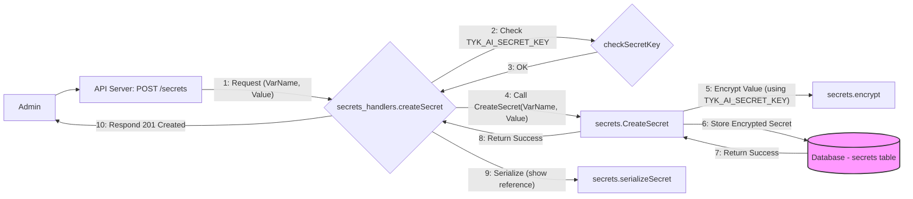
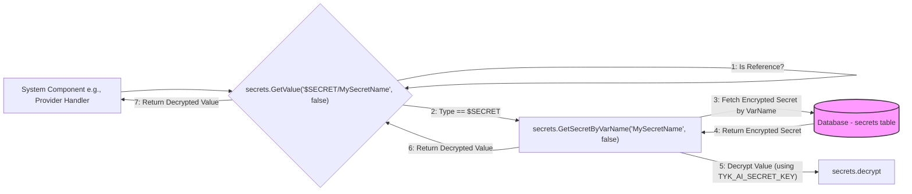

## Secrets Management System

**1. Overview & Purpose**

The Secrets Management system provides a secure way to store and manage sensitive information, such as API keys, tokens, or other credentials, within the Midsommar application. It prevents hardcoding sensitive data directly into configurations or code. Secrets can be referenced indirectly using a special format (`$SECRET/VarName`) and are resolved at runtime when needed.

**Key Objectives:**

*   **Secure Storage:** Encrypt sensitive values at rest in the database using AES-GCM.
*   **Centralized Management:** Provide API endpoints and a corresponding UI section for administrators to perform CRUD operations on secrets.
*   **Reference Mechanism:** Allow referencing secrets indirectly using `$SECRET/VarName` format in configurations. Also supports resolving environment variables using `$ENV/VarName`.
*   **Runtime Resolution:** Provide a mechanism (`secrets.GetValue`) for different parts of the application to resolve these references into actual values when required.
*   **Controlled Access:** Leverage existing API authentication and authorization for managing secrets.
*   **Enable/Disable:** The entire feature is contingent on the presence of the `TYK_AI_SECRET_KEY` environment variable.

**User Roles & Interactions:**

*   **Administrator:** Manages secrets (CRUD operations) via the API (`/secrets` endpoints) or the administrative UI. Uses secret references (`$SECRET/VarName`) when configuring other parts of the system (e.g., Providers, Tools, LLMs, Datasources).
*   **System Components:** Resolve secret references at runtime using `secrets.GetValue` to fetch the actual sensitive data needed for their operation.

**2. Architecture & Data Flow**

**Core Components & Interactions:**

*   **API Handlers (`api/secrets_handlers.go`):** Expose RESTful endpoints for managing secrets. Responsible for CRUD operations, calling the Secrets Service, and checking for `TYK_AI_SECRET_KEY`.
*   **Secrets Service (`secrets` package):** Contains the core logic.
    *   `secrets.Secret` (`secrets/models.go`): Data model (ID, VarName, encrypted Value).
    *   `encrypt`/`decrypt` (`secrets/models.go`): AES-GCM encryption/decryption using `TYK_AI_SECRET_KEY`.
    *   CRUD Functions (`secrets/models.go`): Database interactions (`CreateSecret`, `GetSecretByID`, etc.).
    *   `GetValue` (`secrets/secrets.go`): Resolves `$SECRET/VarName` and `$ENV/VarName` references. Requires DB access for `$SECRET`.
    *   `SetDBRef` (`secrets/secrets.go`): Injects the database connection, necessary for `GetValue` to resolve `$SECRET` references.
*   **Database (`models`):** Stores the `secrets` table.
*   **Consumers (Various Services/Handlers):** Components that use sensitive data.
    *   **LLM Service (`services/llm_service.go`):** Uses `secrets.GetValue` to resolve API keys and endpoints for LLM providers.
        * `GetLLMByID` - Preserves references for API responses
        * `GetLLMByName` - Resolves actual values for internal use
        * `GetActiveLLMs` - Resolves actual values for all active LLMs
    *   **Tool Service (`services/tool_service.go`):** Uses `secrets.GetValue` to resolve authentication keys for tools.
        * `GetToolByID` - Preserves references for API responses
        * `GetToolByName` - Preserves references for API responses
    *   **Datasource Service (`services/datasource_service.go`):** Uses `secrets.GetValue` to resolve connection credentials and API keys.
        * `GetDatasourceByID` - Preserves references for API responses
        * `SearchDatasources` - Preserves references for API responses
    *   **Chat Service (`services/chat_service.go`):** Uses `secrets.GetValue` to resolve credentials for LLMs, tools, and datasources used in chats.
        * `GetChatByID` - Resolves actual values for LLM API keys, tool auth keys, and datasource API keys
    *   **Provider Handlers (`api/provider_handlers.go`):** Uses `secrets.GetValue` to resolve tokens for providers like Tyk Dashboard.
        * `configureProvider` - Resolves actual values for provider tokens

**Data Flow:**

**A) Creating a Secret:**

**B) Resolving a Secret Reference:**

**3. Implementation Details**

*   **Enabling the Feature:** The `TYK_AI_SECRET_KEY` environment variable **must** be set.
*   **Database Initialization:** `secrets.SetDBRef` must be called at startup to enable `$SECRET` resolution via `secrets.GetValue`.
    * This is done in `api/provider_handlers.go` in the `NewProviderAPI` function.
*   **Data Model (`secrets.Secret`):** Stores ID, VarName, encrypted Value, and standard GORM timestamps.
*   **Encryption:** AES-GCM using `TYK_AI_SECRET_KEY`. Encryption occurs on create/update, decryption on retrieval via `GetValue` (when `preserveRef` is false).
*   **Reference Format & Resolution:**
    *   `$SECRET/VarName`: Resolved by looking up `VarName` in the `secrets` table, decrypting the value.
    *   `$ENV/VarName`: Resolved using `os.Getenv(VarName)`, only when `VarName` is listed in `AI_STUDIO_ENV_REF_ALLOWLIST` (empty by default; `secrets.EnvRefAllowed`, `secrets/refpolicy.go`). `GetValue` applies this itself, so every resolve path follows it; `preserveRef` keeps `$ENV/` references as well as `$SECRET/` ones. Writing a new or changed reference needs `secrets:read` (`api.requireSecretReadForCredentials`), submissions and plugin gRPC writes refuse them, snapshot fields go through `secrets.ForEdge` (endpoints, connection strings: a refused reference becomes a bare `$ENV/`) or `secrets.ForEdgeCredential` (keys, tokens, metadata, guardrail connections: it becomes the non-empty `secrets.RefusedCredential`, so no vendor client substitutes its own environment's key), and edges call `secrets.DisableEnvRefs()` at startup.
    *   `secrets.GetValue(reference, preserveRef)`: Central function for resolution. `preserveRef=true` returns the reference string itself, `preserveRef=false` returns the actual resolved value.
    *   API responses for secrets generally use `preserveRef=true` (showing `$SECRET/VarName`).
    *   Internal consumers (like providers) use `preserveRef=false` to get the actual secret.
    *   A credential that did not resolve is never sent (lsj.7): `secrets.CheckCredential` refuses a value that is still a `$SECRET/` or `$ENV/` reference, still `$ENC/`, or `secrets.RefusedCredential`, with `secrets.ErrUnresolvedCredential` (names neither the reference nor the value). It runs where a credential leaves: `switches.FetchDriver` (Studio Chat, the bridges), `switches.GetEmbedder`, `switches.SetVendorAuthHeader` (the gateway, hub and edge; the REST and streaming handlers check first via `switches.CheckLLMCredential` and answer 502 "LLM credential not usable"), and the universal client's tool auth (REST tools). So an edge refuses locally the placeholder the hub sends it instead of passing it to the vendor.
*   **API Endpoints:** Standard RESTful CRUD endpoints under `/secrets`. Supports pagination for listing. Uses standard HTTP status codes for responses and errors.
*   **Logging:** Debug and Error logs exist in handlers and the service package.
*   **Redaction Utility:** `secrets.FilterSensitiveFields` exists to redact sensitive fields in objects by using struct tags.

**4. Use Cases & Behavior**

*   **Storing an API Key:** Admin uses UI/API to create a secret (e.g., `VarName="MyServiceKey"`, `Value="actual_key"`). System stores encrypted key. UI/API shows reference `$SECRET/MyServiceKey"`.
*   **Configuring a Provider:** Admin sets provider token field to `$SECRET/MyTykToken`. At runtime, the provider handler calls `secrets.GetValue("$SECRET/MyTykToken", false)` to get the actual token.
*   **Configuring an LLM:** Admin sets LLM API key field to `$SECRET/OpenAIKey`. The `llm_service` calls `secrets.GetValue(llm.APIKey, false)` when the LLM is used.
*   **Configuring a Tool:** Admin configures a tool requiring an API key, setting the key field to `$SECRET/MyToolKey`. The `tool_service` calls `secrets.GetValue(tool.AuthKey, false)` when the tool is invoked.
*   **Configuring a Plugin:** A top-level plugin config value that is exactly `$SECRET/Name` is resolved for the Studio-side plugin process (`services.pluginInitConfig`). For plugins with a gateway hook, the snapshot also carries the resolved value encrypted for the edge (`PluginConfig.config_secrets_encrypted`, built by `grpc.pluginConfigSecretsForEdge` through `secrets.ForEdgeCredential` and `encryptForMicrogateway`); the plain config keeps the reference. Only references from the plugin's own config are resolved (an LLM config override needs no `secrets:read`), never `$ENV/`. The edge stores the map encrypted (`plugins.config_secrets_encrypted`, `json:"-"`) and the plugin service adapter decrypts it into the `Initialize` config only, for keys whose stored value is a `$SECRET/` reference (`microgateway/internal/services/plugin_config_secrets.go`).
*   **App credentials (midsommar-clean-4x5y.15, 2.3):** an App's gateway key, `credentials.secret`, is stored sealed under the database's data key (`$DK1/`) and found by `credentials.secret_hash`, never by its value. The hub must keep the secret recoverable (the UI and API show it again, and Studio uses it as a bearer token itself for decision calls and the management server), so it is encrypted, not only hashed.
    *   **Why not `secrets.EncryptValue`.** The bead asked for "the same mechanism as LLM credentials". That mechanism derives a key per value (scrypt, or PBKDF2 in FIPS mode, with a per-value salt): about 100 ms per value written, and per value read unless its key is among the 4,096 cached. For a handful of LLM keys that is invisible; for App keys it meant about 80 minutes to migrate 50,000 of them, 10 seconds for the first list of 100 Apps after a restart, and a hub spending 0.1 s of CPU per uncached key it validates. The first revision of this change was built that way and passed every test, because test binaries run the key derivation at a minimal cost; `models/credentialcost` now runs at the production cost.
    *   **Data key** (`secrets/datakey.go`). The key derivation runs once per process: `TYK_AI_SECRET_KEY` and the database's salt give one 256-bit key (scrypt at the usual cost; PBKDF2-HMAC-SHA256 at the FIPS iteration count in FIPS mode), cached for the life of the process. Each secret is sealed with AES-256-GCM, a random 96-bit nonce, and `credential\0<key_id>` as additional authenticated data, so a ciphertext copied into another credential's row does not open. Stored form: `$DK1/s:<base64>` (scrypt-derived key) or `$DK1/p<iterations>:<base64>` (PBKDF2-derived); every build reads both, a FIPS-mode process writes the second and its start-up migration converts the first. Without `TYK_AI_SECRET_KEY` the secret is stored as written, with a warning logged once.
    *   **The salt** (`models/data_key_salt.go`, table `data_key_salts`, one row). 32 random bytes, created once by `EnsureDataKeySalt`, which `studio.New` calls under the migration lock before credentials are migrated; read once per process and cached per opened database (by its connection pool: gorm sessions and transactions each have their own copy of the `gorm.Config`, so that cannot be the key; `TestDataKeySaltIsReadOncePerDatabase_Postgres`). It is not secret; it makes the derived key specific to this database. Every replica reads the same row and a backup carries it. If it is missing while sealed credentials exist, `EnsureDataKeySalt` returns `ErrDataKeySaltLost` and Studio does not start; a credential read then is refused and a credential save fails. A new salt is never generated in its place. (A database Studio did not migrate, as in tests that create only some tables, gets the table and the row on first use.)
    *   **One accessor** (`models/credentials.go`). `Credential.Secret` always holds the plaintext in memory. `BeforeSave` computes `secret_hash` and the sealed form, which the field's serializer writes; `AfterFind` opens what was read, for a credential on its own and as an App's association (`Preload("Credential")`, saving an App with its credential loaded), so no reader had to change. A save never puts the stored form in `Secret`: one that fails (a database error during a failover) leaves the plaintext in place and can be retried as it is, and a struct that does hold a stored form is saved as what it opens to. The serializer refuses a secret that did not go through `BeforeSave`. A column or map update of the secret would bypass the hooks; there is none, and `TestCredentialSecretIsOnlySavedWhole` fails if one appears outside the migration.
    *   **No decryption where the plaintext is not needed.** `Credential.GetBySecret` (the embedded gateway's lookup) and the control server's `ValidateToken` find the row by its hash and leave the secret column out of the query; `GetBySecret` hands back the secret it was given. Only showing the key, Studio's own bearer use and computing the hash edges hold open a secret, at microseconds each.
    *   **Lookup hash** (`secrets.LookupHash`). With `TYK_AI_SECRET_KEY` of 14 bytes or more: `k:` followed by a `pkg/credhash` hash (HKDF-SHA-256, then HMAC-SHA-256) keyed with `TYK_AI_SECRET_KEY`. Without a key, or with a shorter one (which that construction refuses in FIPS mode): `u:` followed by a plain SHA-256. The prefix says which, so rows hashed before a key was set are found and rehashed. The key is the hub's own on purpose: the hash edges hold (`pkg/credhash` keyed with `MICROGATEWAY_ENCRYPTION_KEY`) is computed from the decrypted secret when credentials are sent, so rotating the edge key needs no hub migration. `secret_hash` is unique and nullable: null on a row no current Studio has migrated, which is then found by nothing. An empty secret finds nothing.
    *   **Unreadable secrets.** A stored secret that cannot be opened (key unset or changed, salt missing, another row's ciphertext) reads as `secrets.RefusedCredential`, never as its stored form; the row keeps its stored value when it is saved for another reason (deactivation), so the right key reads it again.
    *   **Migration** (`models.MigrateCredentialsAtRest`, called by `studio.New` under the migration lock, after the salt). Rows not in their final form, soft-deleted ones included, are read in batches by id and written one at a time with a compare-and-set on the secret that was read: idempotent, resumable after an interruption, safe beside another replica. Not in final form: no hash, a hash of the other kind, a plaintext secret while a key is set, a secret in the `$ENC/` form (which an earlier revision of this change wrote on development stacks), or a data key derived with scrypt when this process is in FIPS mode. One key derivation in all, whatever the number of rows; measured at production cost: 10,000 rows in 1.3 s on SQLite and 6.8 s on Postgres 16, 50,000 in 7 s and 34 s. A secret that cannot be opened is left as it is and logged. Of two rows with one secret only one can keep the hash: the one that validated before the change, which is the first by id among the live (not soft-deleted), active rows, as the control server's lookup skipped the others; with no such row, the lower id. The other is encrypted, left without a hash and named in the log at every start until its key is regenerated. No flow creates such rows: secrets come only from `models.NewCredential` (32 random bytes), and the API's credential input never sets one. `updated_at` is not touched.
    *   **One-way.** Schema 42, minimum reader 42 (`models/schema_version.go`): older code looks credentials up by the plaintext secret and would show and send the ciphertext. An older headless control plane refuses the database; an older full Studio does not check and must be stopped first (changelog, Upgrade notes > Database).
    *   **Not in clear elsewhere.** App events and object hooks carry `[redacted]` (`RedactAppCredentials`), the audit trail redacts `secret` and never sees `secret_hash` (`json:"-"`), and SQL logs carry values only with `DB_LOG_SQL_PARAMS=true`; lookups no longer put the key in a statement at all (`TestAppKeyIsNotInSQLLogsOrEvents`).
*   **Literal LLM credentials (aa5, 2.3):** an LLM's API key and its credential metadata values (`models.IsCredentialMetadataKey`: the key name contains `key`, `secret` or `token`; values per `models.LLMCredentialValue`, so references, empty values and `[redacted]` are left alone) are stored as `secrets.EncryptValue` output (`$ENC/`).
    *   **Hooks.** The LLM's `BeforeSave` encrypts them and `AfterFind`/`AfterSave` decrypt them (`models/llm_credentials.go`), so every gorm reader sees plaintext, and a save that leaves a value unchanged keeps its ciphertext. A map update runs no hook: `UpdateLLMMetadata` encrypts itself (`EncryptLLMMetadata`).
    *   **Backfill.** `BackfillLLMCredentialEncryption` encrypts older rows at startup, with a compare-and-set per row.
    *   **No key or the wrong key.** Without `TYK_AI_SECRET_KEY` values are stored as written, with a warning. A value that does not decrypt reads as `secrets.RefusedCredential`, which `ForEdgeCredential` also sends for anything still `$ENC/`.
    *   **Schema version.** `MinReaderSchemaVersion` is 23, so older replicas refuse the database.
    *   **Edges.** Credential metadata goes in `LLMConfig.metadata_secrets_encrypted` (`grpc.llmMetadataForEdge`, deterministic `encryptForMicrogateway`), with `RefusedCredential` in the metadata JSON so pre-2.3 edges fail closed. Every credential field of the snapshot (LLM api_key and credential metadata, tool auth_key, datasource db_conn_api_key and embed key, a semantic router's standalone embedder key, and a guardrail's secret connection fields in `guardrails.ConfigJSONForEdge`) goes through `secrets.CredentialRefForEdge` semantics: a reference that is refused, unresolvable or resolves to an empty secret is sent as `RefusedCredential`, never empty; a field with no value stays empty (0eu). The edge stores it in `llms.metadata_secrets_encrypted` (`json:"-"`) and lays it over the metadata in `convertDatabaseLLMToModel` (`microgateway/internal/services/llm_metadata_secrets.go`). A standalone edge's own writes split it the same way, and its admin API shows `[redacted]`.
    *   **Payloads and logs.** Events, every object hook and the API carry `models.RedactLLMCredentials` (a before-hook's untouched `[redacted]` is restored, `RestoreLLMCredentials`). Tools, datasources and users get the same treatment in their `system.*` events and every object hook (`models.RedactObjectCredentials` / `RestoreObjectCredentials`, `models/object_credentials.go`): tool auth key (and dependencies'), datasource connection string, connection API key and embedder key, user password hash, API key and tokens; references kept. Guardrail filters (2ze): the literal values of connection fields the provider marks Secret, or does not declare (`guardrails.IsSecretConnectionField`), in `system.filter.*` events and in a tool's or LLM's `Filters` (events and hooks; restored by filter ID). Apps and groups (aia, events only; they have no hooks): an App's `Credential.Secret` and its LLMs', tools' and datasources' credentials; a group's members and its catalogues' LLMs, datasources and tools. SQL logs carry no values unless `DB_LOG_SQL_PARAMS=true` (`GormLogger.ParamsFilter`, the edge's `ParameterizedQueries`).
*   **Rotating a referenced secret:** Secret create, update and delete emit `system.secret.*` (ID only, no value). The control server recomputes the snapshot checksum on them, so edges whose config uses the secret show as pending; the push carries the new value and the edge reloads the plugin (`ReconcilePlugins` sees the changed config).
*   **Configuring a Datasource:** Admin sets datasource connection credentials to `$SECRET/DBPassword`. The `datasource_service` calls `secrets.GetValue(datasource.DBConnAPIKey, false)` when connecting to the datasource.
*   **Using in Chat Sessions:** When a chat uses LLMs, tools, or datasources with secret references, the `chat_service` resolves these references to actual values before use.
*   **Viewing/Editing Secrets:** Admin uses UI/API. Secrets are always displayed/returned in their reference format (`$SECRET/VarName`), never the actual decrypted value. Editing requires providing the new plaintext value, which is then encrypted.
*   **Deleting a Secret:** Admin deletes via UI/API. The database record is removed. Subsequent attempts to resolve its reference will fail.
*   **Feature Disabled:** If `TYK_AI_SECRET_KEY` is unset, `/secrets` API calls fail (503), and `$SECRET` resolution via `GetValue` fails (likely returning the reference string and logging errors).

**5. Potential Considerations & Future Enhancements**

*   **`TYK_AI_SECRET_KEY` Management:** Security, rotation, and deployment are critical.
*   **Key Rotation:** No built-in support. Manual process required.
*   **Access Control:** Relies on general API auth; no per-secret granularity.
*   **Error Handling for Unresolved References:** Consumers need robust handling if `GetValue` fails (deleted secret, missing key, DB ref not set).
*   **External Secret Managers:** Integration could offer enhanced features (Vault, AWS/GCP Secrets Manager).
*   **Secret Versioning:** Not supported; updates overwrite previous values.
*   **Automatic Secret Detection:** Implement scanning for potential secrets in configurations and suggest using the secret reference mechanism.
*   **Secret Usage Tracking:** Add functionality to track which components are using which secrets for better management and security auditing.